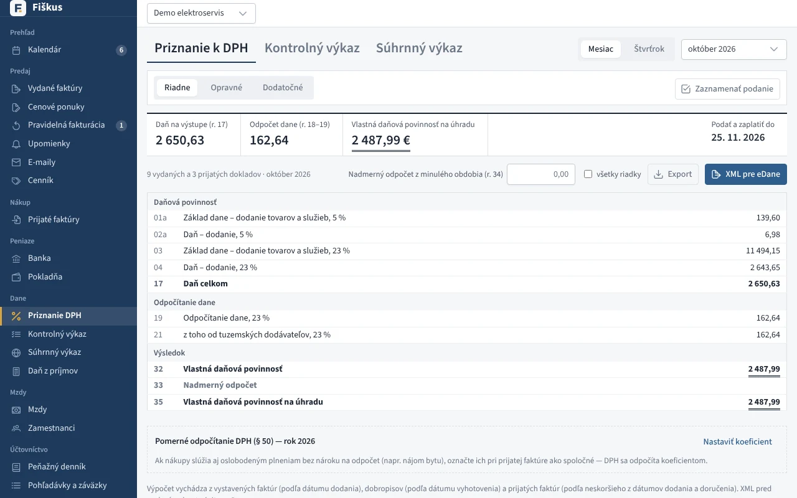
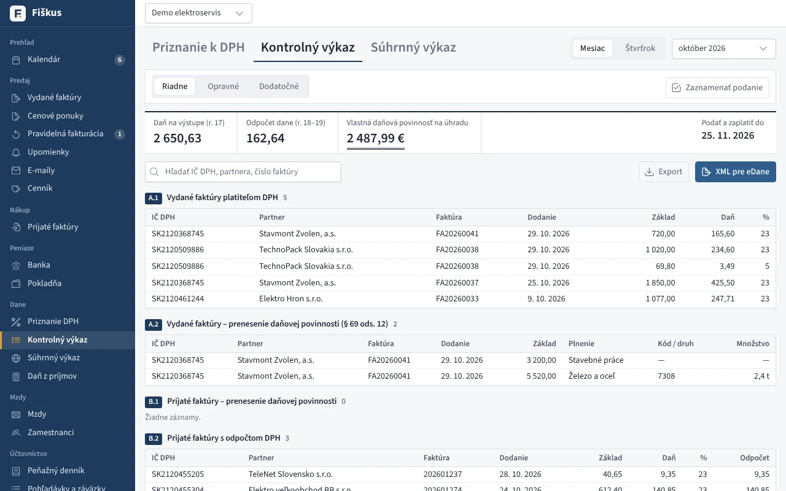
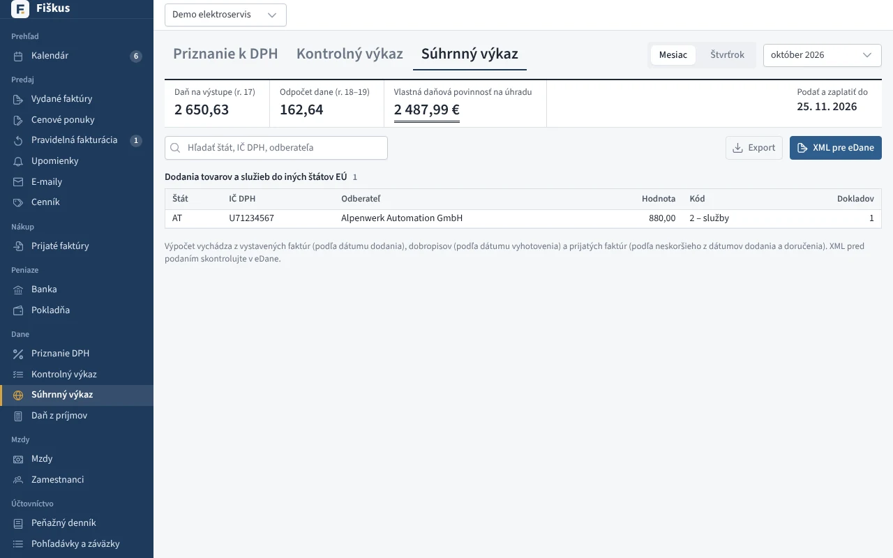
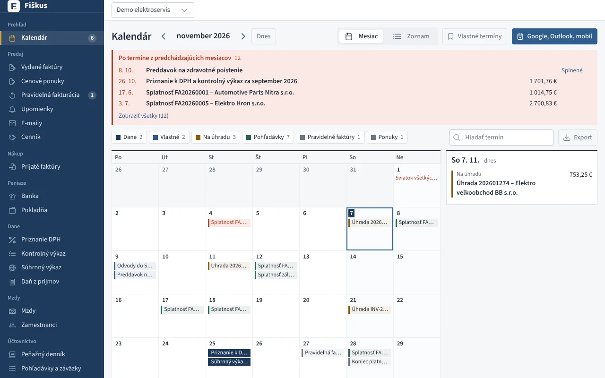

# Dane

Priznanie aj výkazy sa **počítajú z dokladov** za zvolené obdobie (mesiac
alebo štvrťrok). Každý riadok sa dá rozkliknúť až na doklady, z ktorých
vznikol — na hodine to je najlepší spôsob, ako ukázať, odkiaľ sa čísla
v tlačive berú.

*Priznanie k DPH po riadkoch — každý riadok sa dá rozkliknúť na doklady*

| Tlačivo | Verzia | Výstup |
|---|---|---|
| Priznanie k DPH | DPHv25 | XML pre eDane, náhľad po riadkoch |
| Kontrolný výkaz | KVDPHv25 | XML, časti A.1, A.2, B.1–B.3, C.1, C.2, D.1 |
| Súhrnný výkaz | SVDPHv20 | XML, kódy 0, 1, 2 |

Opravné a dodatočné priznanie: dátum zistenia, rozdiel oproti poslednej
známej povinnosti (r. 36), záznam o podaní.

*Kontrolný výkaz — časti A.1, A.2, B.1 až B.3*

*Súhrnný výkaz — dodania do iných štátov EÚ*

:::warning[Podanie je na vás]
Fiškus pripraví XML, ktoré nahráte na portál finančnej správy. Priamo
nepodáva — podanie vyžaduje vaše prihlásenie na portáli.
:::

## Kalendár termínov

Lehoty pre DPH, kontrolný a súhrnný výkaz, daň z príjmov a daň z motorových
vozidiel — posunuté na pracovný deň. K tomu splatnosti faktúr, pravidelné
faktúry, vlastné opakované termíny (odvody, STK, poistky) a úlohy zo
[zákaziek, ponúk a adresára](../predaj/zakazky.md#zaznamy-a-ulohy), pri autoservise aj STK/EK
a servis [vozidiel zákazníkov](../predaj/zakazky.md#vozidla). Kalendár sa dá
odoberať do mobilu (iCalendar) alebo prepojiť s Google Kalendárom a
Outlookom.

*Kalendár: daňové lehoty, splatnosti a vlastné termíny*

V **Nastaveniach → E-mail** zadáte adresu pre **upozornenia na lehoty** a
koľko dní vopred (1 až 14). Fiškus potom pošle e-mail o každom blížiacom sa
daňovom termíne, vlastnom termíne a splatnej prijatej faktúre — raz za termín,
nie skôr ako o 7:00.
