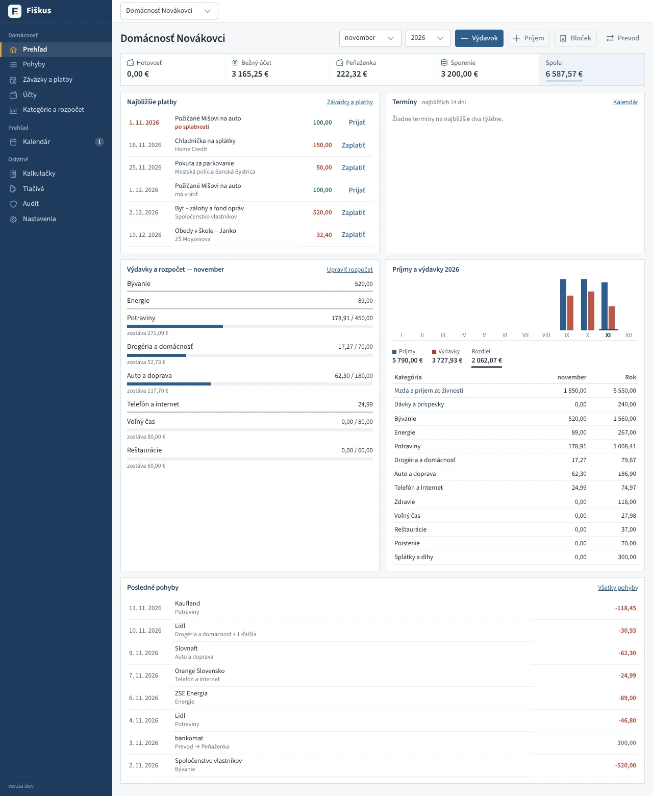
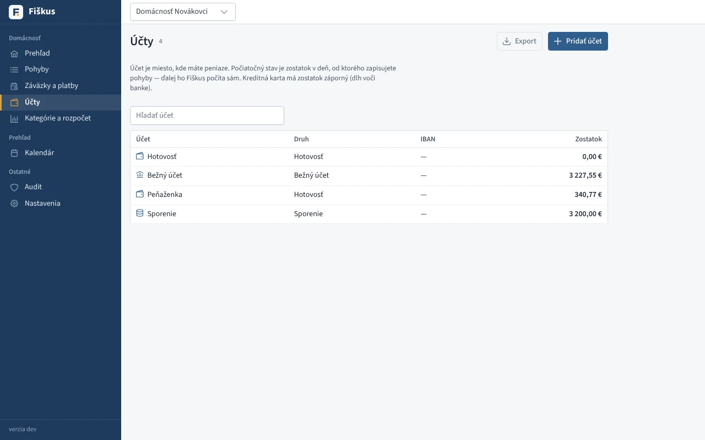
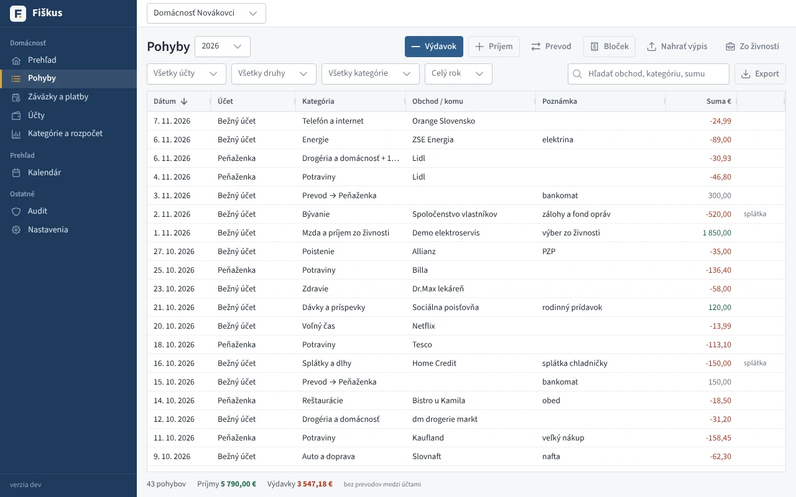
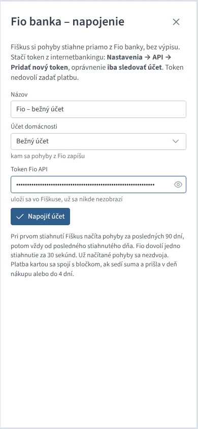
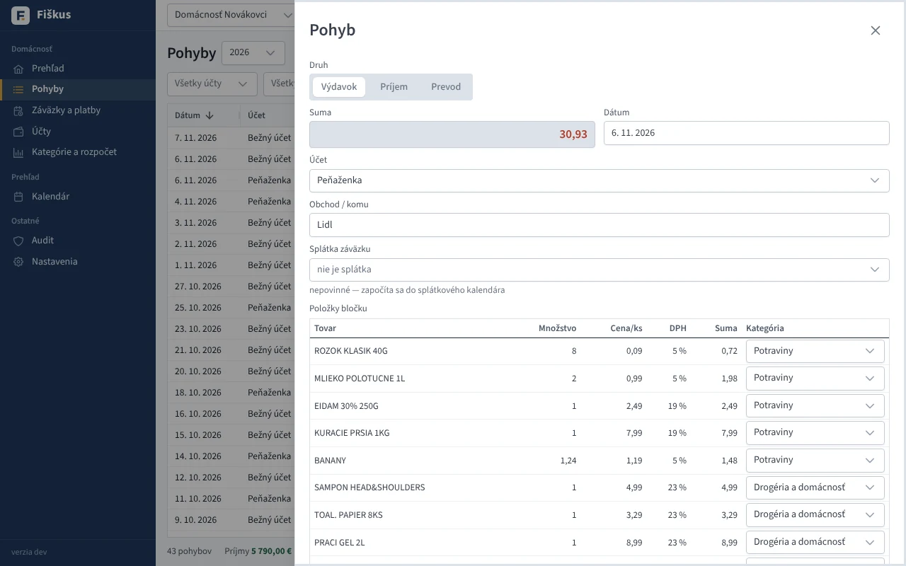
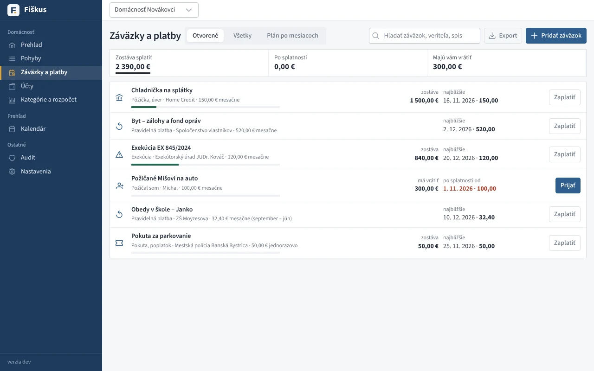
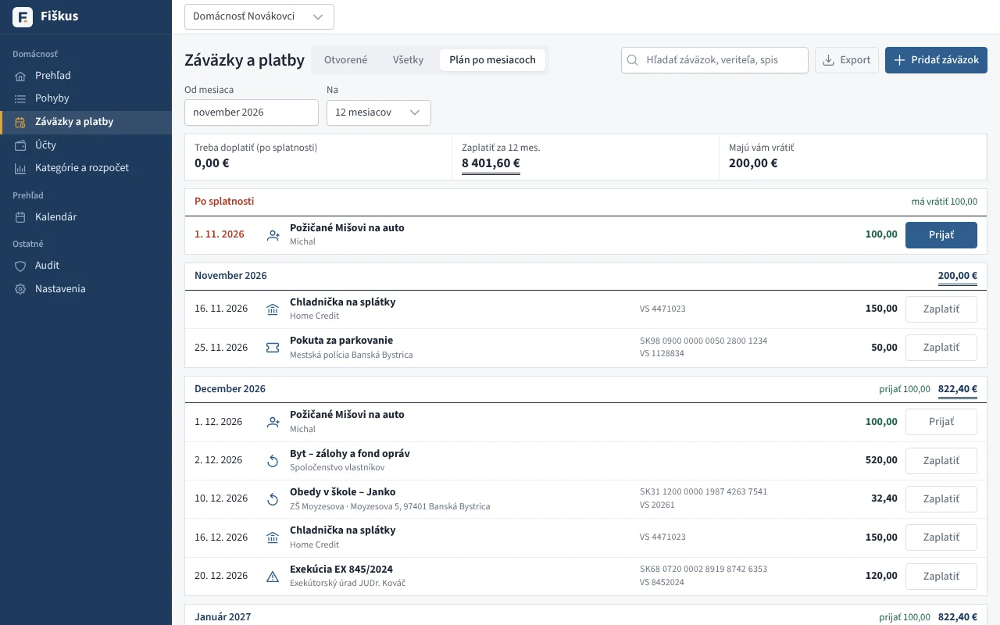
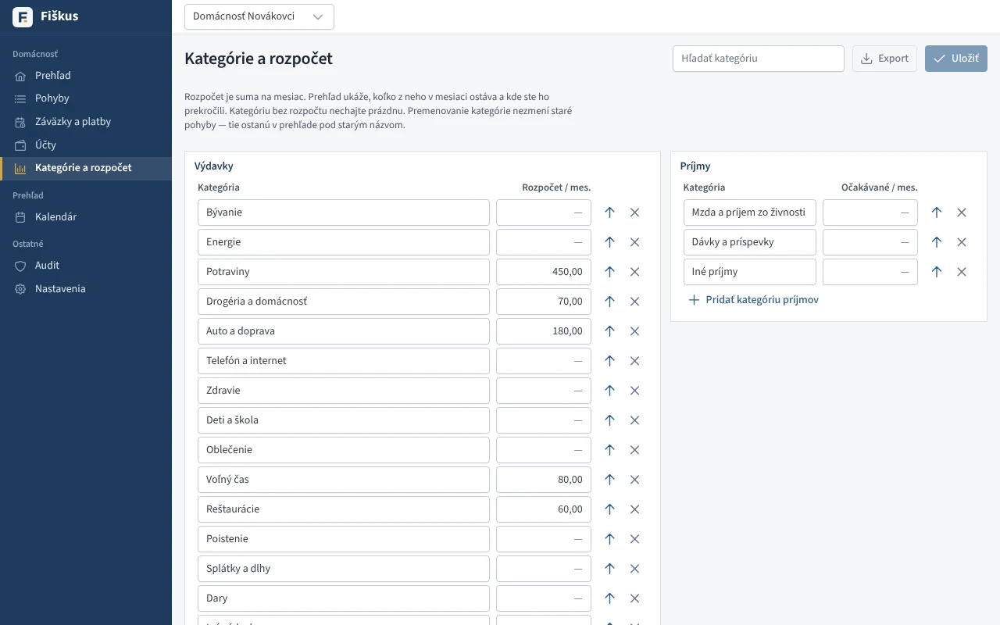

# Domácnosť

Domáce účtovníctvo vediete v samostatnej **domácnosti** — vo Fiškuse je to
zvláštny druh „firmy“ bez IČO, DPH a dokladov. Založíte ju v časti
**Nastavenia → Firmy a domácnosti → Založiť domácnosť**. Medzi firmou a domácnosťou sa prepínate hore v hlavičke.

Úvodná stránka domácnosti je **Prehľad**: zostatky účtov, najbližšie
platby, termíny z kalendára na 14 dní, rozpočet mesiaca, graf príjmov
a výdavkov za rok a posledné pohyby.

*Prehľad domácnosti: účty, najbližšie platby, rozpočet a rok*

## Účty

Účet je miesto, kde máte peniaze: bežný účet, peňaženka, kreditná karta,
sporenie. Pri účte zadáte **počiatočný stav** — zostatok v deň, od ktorého
zapisujete pohyby. Ďalej ho Fiškus počíta sám. Účet s pohybmi sa nedá
zmazať; keď ho zrušíte v banke, označte ho ako zrušený.

*Účty domácnosti so zostatkami*

## Pohyby

*Pohyby — príjmy, výdavky a prevody s kategóriami*

| Druh | Čo to je |
|---|---|
| Výdavok | nákup, platba, splátka — znižuje zostatok účtu |
| Príjem | mzda, peniaze zo živnosti, dávky — zvyšuje zostatok |
| Prevod | výber z bankomatu, presun na sporenie — do príjmov ani výdavkov sa nepočíta |

Kategóriu navrhne Fiškus podľa obchodu: najprv podľa toho, kam ste rovnaký
obchod zaradili naposledy, potom podľa známych obchodov (Lidl → Potraviny,
Slovnaft → Auto a doprava, ZSE → Energie…).

**Výpis z banky** (camt.053, GPC, CSV, Excel) nahráte tlačidlom *Nahrať
výpis*. Kategórie sa navrhnú rovnako; opakované nahratie toho istého výpisu
nič nezdvojí. Platby v cudzej mene sa vynechajú.

**Fio banka** sa dá napojiť priamo, bez výpisu: v Pohyboch alebo v Účtoch *Napojiť Fio*,
vyberte účet domácnosti a vložte token z internetbankingu Fio (Nastavenia →
API, oprávnenie *iba sledovať účet*). Tlačidlo **Stiahnuť z Fio** potom
načíta nové pohyby. Podrobnosti o tokene a limitoch banky sú v časti
[Banka](../peniaze/index.md#fio-banka-priamo-bez-vypisu).

*Napojenie domácnosti na Fio banku*

### Bločky a platby kartou

Nákup zaplatený kartou je raz bloček a raz platba v banke. Fiškus ich spojí
do jedného výdavku: bloček (s položkami a kategóriami) sa presunie na
bankový účet a platba z banky sa už zvlášť nezapíše.

- Spoja sa, keď sedí suma a platba prišla v deň nákupu alebo do 4 dní
  po ňom. Ak sú dva rovnaké bločky, rozhodne názov obchodu v texte platby;
  keď sa nedá rozhodnúť, nespoja sa.
- Funguje to v oboch smeroch: pri sťahovaní z Fio alebo nahratí výpisu
  (bloček už je zapísaný) aj pri zapísaní bločku (platba už prišla).
- Spojený bloček má v detaile poznámku *Spárovaný s platbou kartou
  z banky*. Ten istý výpis ani stiahnutie z Fio ho už nezdvojí.

## Bločky

Tlačidlo **Bloček** (v prehľade aj v pohyboch) otvorí fotoaparát alebo výber
fotky. Bloček odfoťte celý, aj s QR kódom.

*Detail bločku z eKasy — položky, ceny za kus, DPH a kategórie*

| Bloček | Odkiaľ sú položky |
|---|---|
| s QR kódom eKasa | priamo z Finančnej správy — presné názvy a ceny |
| bez QR kódu | Fiškus ho prečíta z fotky cez Claude API (kľúč v Nastaveniach → Prístup pre AI) |

Každú položku Fiškus zaradí do kategórie: rožky a mlieko do potravín,
šampón do drogérie, lieky do zdravia. Pred zapísaním ich skontrolujete
a zmeníte; tlačidlom *Všetky do kategórie…* zaradíte celý nákup naraz.
Ako položku zaradíte, tak ju Fiškus navrhne nabudúce. Zľava je samostatná
položka, rozdiel k celkovej sume (zaokrúhlenie) tiež.

Bloček sa zapíše ako jeden výdavok rozdelený na položky; prehľad
a rozpočet počítajú každú kategóriu zvlášť. Fotka ostane pri pohybe.
Ten istý bloček sa druhýkrát nezapíše.

Na telefóne spárovanom s programom (*Mobil v sieti*) sa bloček po odfotení
zapíše hneď s navrhnutými kategóriami, upraviť ich môžete neskôr v Pohyboch.

## Peniaze zo živnosti

Tlačidlo *Zo živnosti* ukáže výbery a vklady podnikateľa z peňažného denníka
vašej živnosti — pohyby zaradené do stĺpcov *mimo základu dane*. Výber sa
v domácnosti zapíše ako príjem, vklad do živnosti ako výdavok. Prenesený
pohyb sa druhýkrát neprenesie.

## Záväzky a platby

Sem patria pôžičky a úvery, dlhy, exekúcie, pravidelné platby (nájom,
zálohy na energie, poistky) aj peniaze, ktoré ste niekomu požičali.

*Záväzky a platby — pôžičky, exekúcie, pravidelné platby, pokuty*

*Plán po mesiacoch: čo a kedy zaplatiť a koľko treba za mesiac*

| Údaj | Na čo slúži |
|---|---|
| Dlžná suma | celkom, pri exekúcii vrátane trov; pri pravidelnej platbe sa nezadáva |
| Splatené skôr | čo ste zaplatili pred evidenciou vo Fiškuse |
| Splátka, opakovanie, prvá splátka | z nich Fiškus zostaví splátkový kalendár |
| Počet splátok | 0 = kým sa dlh nesplatí (pri pravidelnej platbe bez konca) |
| Kategória a účet | predvyplnia sa pri zaplatení |

V detaile záväzku aj v okne **Zaplatiť** sú **platobné údaje** v poradí,
ako ich pýta internetbanking: príjemca, IBAN, suma najbližšej splátky,
variabilný a špecifický symbol, správa pre príjemcu a adresa. Každý údaj
skopírujete jedným klikom a vložíte do banky. QR kód PAY by square
načítate v mobilnej banke. Meno príjemcu v banke a správu pre príjemcu
(napr. meno dieťaťa a trieda) vyplníte pri záväzku.

Tlačidlom **Zaplatiť** zapíšete splátku ako výdavok (pri požičaných peniazoch
**Prijať** ako príjem). Splátku môžete priradiť aj pri bežnom zápise pohybu
v poli *Splátka záväzku*. Zaplatené sa započíta do splátok v poradí
splatnosti; nezaplatená splátka po termíne je červená.

Splátky sú v **Kalendári** a v prehľade domácnosti (najbližší mesiac
a všetko po splatnosti). Ak máte v **Nastaveniach → E-mail** zapnuté
upozornenia na lehoty, Fiškus pripomenie splátky e-mailom vopred.

## Adresár

V **Adresári** si vediete partnerov domácnosti: ľudí, obchody, úrady, školu,
správcu bytu. Pri kontakte stačí meno, adresa, telefón, e-mail a IBAN.

IBAN (pri kontakte, záväzku aj účte) Fiškus skontroluje hneď pri písaní
a pri slovenskom a českom účte ukáže banku, napr. *Tatra banka*.

Ak má partner viac účtov (škola: stravné, poplatky za ŠKD, rodičovský
fond), pridáte ich v časti **Ďalšie účty** aj s účelom. Pri záväzku potom
v poli *IBAN príjemcu* vyberiete, na ktorý účet sa platí. Platby z ktoréhokoľvek
z týchto účtov sa partnerovi priradia samy.

Partnera vyberiete pri pohybe v poli *Obchod / komu* alebo pri záväzku
v poli *Komu platím*. Návrhy z adresára sú označené ikonou adresára.
Pri záväzku sa z adresára doplnia aj prázdny IBAN a adresa príjemcu.
Pohyby z banky sa k partnerovi priradia samy, podľa IBAN protiúčtu alebo
rovnakého mena.

V detaile kontaktu sú **Platby**: koľko ste partnerovi zaplatili tento rok
a spolu, jeho záväzky a pravidelné platby a zoznam pohybov. Rátajú sa aj
staršie pohyby bez priradeného partnera, ak sa príjemca volá rovnako.

## Rozpočet

V časti **Kategórie a rozpočet** zadáte pri kategóriách výdavkov sumu na
mesiac. Prehľad ukáže, koľko z rozpočtu v mesiaci ostáva; prekročené
kategórie sú červené. Kategórie si môžete premenovať, pridať aj odobrať.

*Kategórie a mesačný rozpočet*

