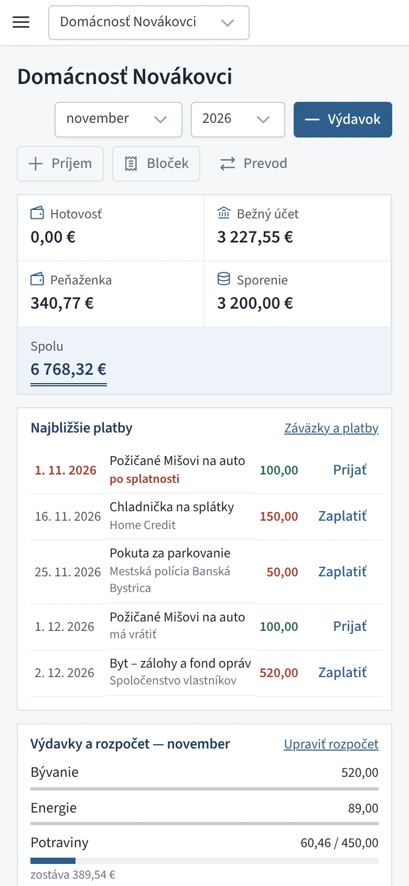
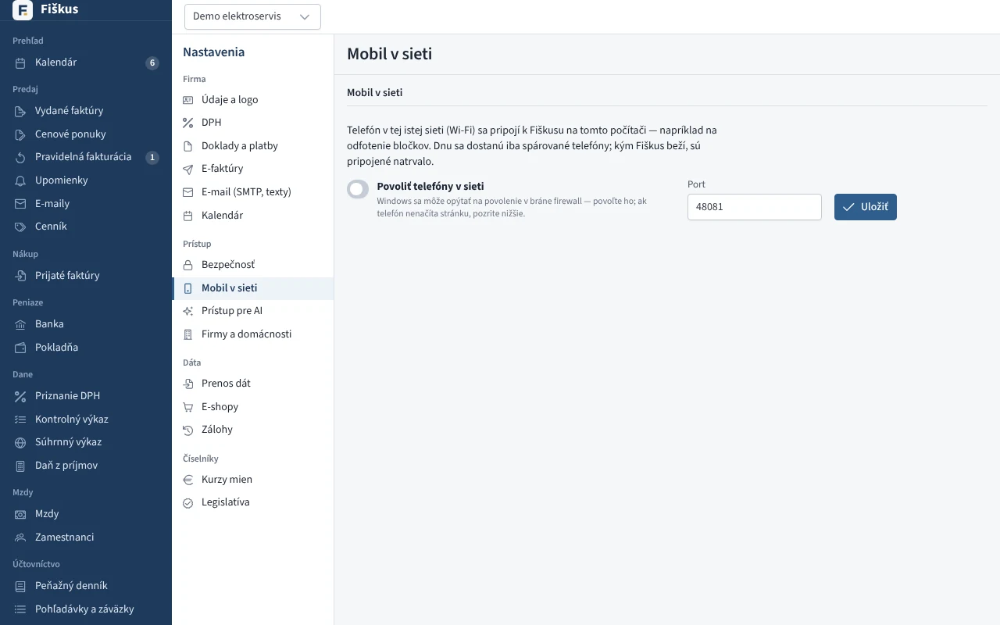
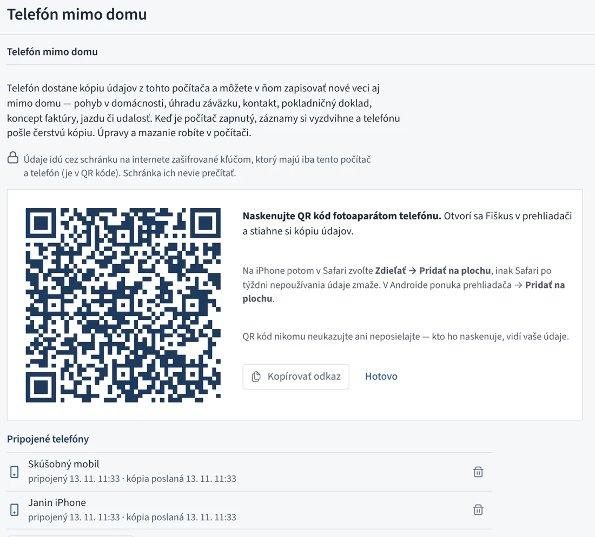
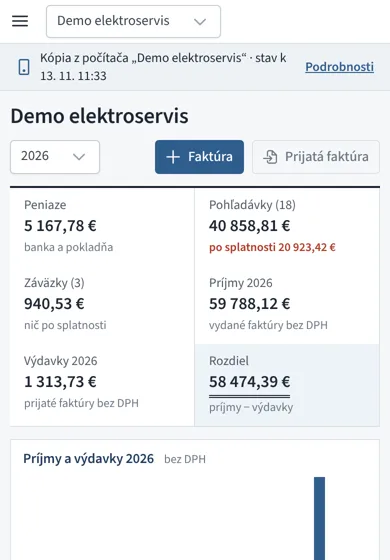

# Mobil

## Bločky z mobilu

Na adrese `/m` je jednoduchá stránka pre telefón, ktorú si pridáte na
plochu. Tlačidlo **Odfotiť bloček** otvorí fotoaparát:

*Fiškus na mobile — domácnosť a tlačidlo Bloček*

1. QR kód na bločku sa prečíta **priamo v telefóne**.
2. Fiškus si podľa kódu stiahne doklad z eKasy Finančnej správy —
   dodávateľa, položky a DPH.
3. Vznikne uhradený prijatý doklad so zmenšenou fotkou bločku.

Spôsob úhrady (hotovosť, karta) si telefón pamätá. Ak sa QR kód nedá
odfotiť, opíšete kód bločku (začína `O-`), ktorý je pod ním.

## Telefón k desktopu v sieti

Desktopový Fiškus beží na počítači a telefón sa k nemu pripojí cez domácu
alebo firemnú Wi-Fi.

*Nastavenia → Mobil v sieti: povolenie a párovanie telefónov*

| Krok | Kde |
|---|---|
| 1. Zapnúť prístup z miestnej siete | Nastavenia → Mobil v sieti |
| 2. Spárovať telefón | QR kód na obrazovke, jednorazový kód platí 5 minút |
| 3. Pracovať | telefón ostáva spárovaný natrvalo, kým ho nezrušíte |

:::info[Prečo spárovanie a nie heslo]
Desktop nemá používateľov ani heslá — patrí jednému človeku. Spárovaný
telefón dostane vlastný dlhý kľúč, ktorého odtlačok si Fiškus pamätá; stratený
telefón zrušíte jedným klikom. Správa programu (nastavenia, zálohy,
používatelia) je z telefónu zakázaná.
:::

## Telefón mimo domu

Telefón má **kópiu údajov z počítača** aj vtedy, keď nie ste doma a počítač
je vypnutý. Nové veci zapíšete v telefóne a do počítača sa prenesú samy,
keď bude zapnutý.

*Nastavenia → Telefón mimo domu: QR kód na pripojenie telefónu*

| Krok | Kde |
|---|---|
| 1. Pripojiť telefón | v počítači Nastavenia → Telefón mimo domu → **Pripojiť telefón**, QR kód naskenovať fotoaparátom telefónu |
| 2. Pridať na plochu | Android: ponuka prehliadača → **Pridať na plochu** |
| 3. Pracovať | telefón ukazuje firmy a domácnosti z počítača; pruh hore hovorí, z kedy je kópia a čo čaká na prenos |

{ width="320" }
*Kópia z počítača v telefóne*

:::warning[iPhone: najprv na plochu, potom pripojiť]
Na iPhone má Fiškus pridaný na plochu **vlastné údaje** — kópiu z karty
prehliadača nevidí a ukáže sa prázdny. Postup:

1. V telefóne otvorte app.fiskus.online a zvoľte Zdieľať → **Pridať na plochu**.
2. Spustite Fiškus z plochy a ťuknite na **Pripojiť k počítaču**.
3. V počítači zvoľte Nastavenia → Telefón mimo domu → Pripojiť telefón
   a v telefóne **odfoťte QR kód** z obrazovky počítača (alebo vložte odkaz
   z tlačidla Kopírovať odkaz).
:::

**Bločky:** v pruhu hore ťuknite na **Bloček** a odfoťte ho. Bloček sa
pošle do počítača a ten ho spracuje, keď bude zapnutý — údaje z eKasy,
položky do kategórií, fotka pri pohybe. V telefóne ho uvidíte po ďalšej
kópii z počítača.

**Čo sa dá v telefóne zapísať:** pohyb v domácnosti, úhrada záväzku, nový
kontakt, pokladničný doklad, koncept faktúry, prijatá faktúra, cenová ponuka,
jazda a udalosť v kalendári. Úpravy a mazanie existujúcich záznamov robíte
v počítači — telefón ich odmietne s vysvetlením. Čísla dokladov prideľuje iba
počítač, takže sa nikdy nezopakujú.

**Ako to beží:** počítač každých 10 minút skontroluje, či telefón niečo
poslal. Záznamy zapíše (v audite ako „Telefón mimo domu“) a telefónu pošle
čerstvú kópiu. Telefón si kópiu stiahne pri otvorení a potom každé 2 minúty;
keď je nová, ponúkne **Načítať novú kópiu**. Ak počítač niektorý záznam
neprijme (napr. účet medzitým zmazali), telefón ho ukáže v Nastaveniach
→ Telefón mimo domu s dôvodom.

:::info[Bezpečnosť]
Údaje idú cez schránku na internete (sync.fiskus.online), ale **zašifrované**
kľúčom, ktorý majú iba počítač a telefón — je v QR kóde za znakom `#`, ktorý
sa na server neposiela. Schránka ich nevie prečítať. Do telefónu nejdú heslá
ani prístupové kľúče k iným službám (e-mail, banka, e-shopy, AI). QR kód
nikomu neukazujte. Telefón odpojíte v počítači ikonou koša — jeho schránka sa
zmaže; nepoužívaná schránka zanikne sama po 60 dňoch.
:::

:::tip[Vlastná schránka]
Kto chce mať schránku pod vlastnou správou, nasadí si ju na bezplatný
Cloudflare podľa návodu v repozitári (`sync-relay/README.md`) a jej adresu
zadá v Nastaveniach → Telefón mimo domu → Vlastná schránka.
:::

