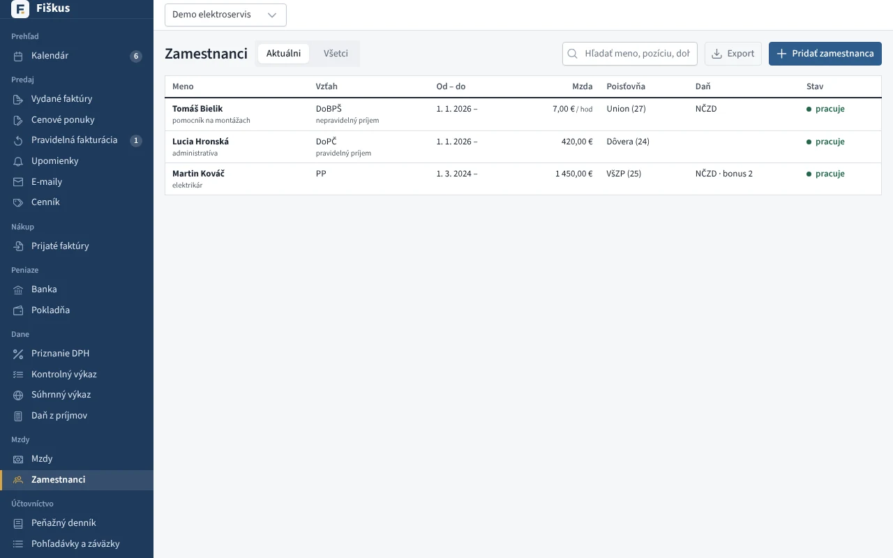
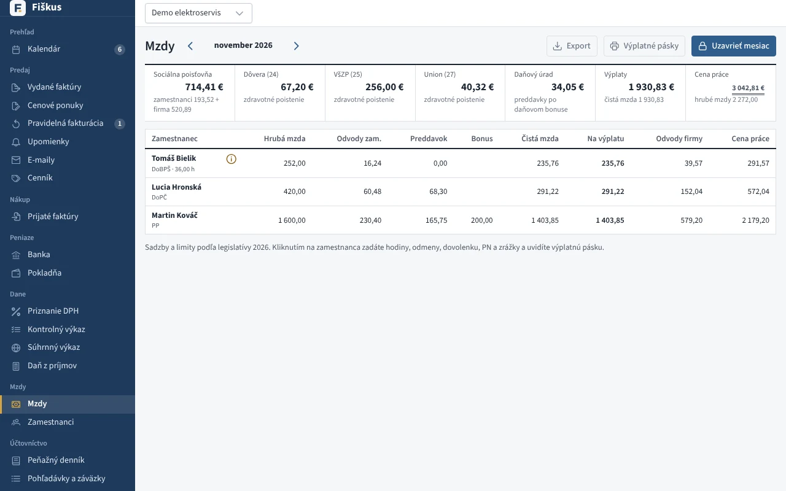

# Mzdy

Fiškus vypočíta mzdy zamestnancov v pracovnom pomere aj odmeny z dohôd:
poistné do Sociálnej poisťovne po fondoch, zdravotné poistenie, preddavok
na daň, daňový bonus na deti, čistú mzdu a cenu práce. Počíta roky 2025
a 2026 podľa sadzieb a limitov platných v danom roku.

## Zamestnanci

V časti **Mzdy → Zamestnanci** zadáte pri každom:

*Zamestnanci — pracovný pomer aj dohody*

| Údaj | Na čo sa použije |
|---|---|
| Druh vzťahu | pracovný pomer, DoPČ, DoVP, DoBPŠ — určuje fondy sociálneho poistenia |
| Pravidelný mesačný príjem (dohody) | dohoda s pravidelnou odmenou má poistenie ako pracovný pomer |
| Mesačná mzda alebo hodinová sadzba | základná mzda; pri hodinovej sa násobí odpracovanými hodinami |
| Zdravotná poisťovňa | súčty zdravotného poistenia podľa poisťovní |
| Dôchodok | starobný: bez invalidného poistenia a poistenia v nezamestnanosti; invalidný nad 70 %: bez poistenia v nezamestnanosti |
| ZŤP | znížená sadzba zdravotného poistenia |
| Odvodová výnimka 200 € | študent na DoBPŠ a dôchodca na dohode — sociálne poistenie až zo sumy nad 200 € (iba na jednej dohode); úrazové a garančné poistenie platí zamestnávateľ z celej odmeny |
| Vyhlásenie na NČZD | nezdaniteľná časť základu dane sa uplatní mesačne |
| Daňový bonus | deti s rodným číslom; vek a mesiace sa určia ako v daňovom priznaní |

## Výplatná listina

V časti **Mzdy** je výplatná listina mesiaca. Kliknutím na zamestnanca
zadáte mesačné údaje — odpracované hodiny, inú základnú mzdu (časť
mesiaca), odmeny, náhradu mzdy za dovolenku alebo sviatok, náhradu príjmu
pri PN a zrážky — a uvidíte celú výplatnú pásku.

*Výplatná listina za mesiac s odvodmi a daňou*

Hore sú súčty na úhradu: **Sociálna poisťovňa** (zamestnanci aj firma),
**zdravotné poisťovne** zvlášť, **daňový úrad** (preddavky po daňovom
bonuse) a **výplaty**. Výplatné pásky vytlačíte alebo uložíte do PDF, dve
na hárok A4.

**Uzavrieť mesiac** uloží výsledky tak, ako sú — po zmene mzdy alebo údajov
zamestnanca sa uzavretý mesiac neprepočíta. Otvoriť ho môžete s uvedením
dôvodu (zapíše sa do auditu). Zamestnanca s uzavretou mzdou nezmažete,
zadáte mu koniec pracovného vzťahu.

## Ako Fiškus počíta

- **Sociálne poistenie** po fondoch z hrubej mzdy, najviac z maximálneho
  vymeriavacieho základu (2026: 16 764 €; úrazové bez maxima); každý fond
  sa zaokrúhľuje na eurocent nadol.
- **Zdravotné poistenie** 2026: zamestnanec 5 %, firma 11 % (ZŤP 2,5 %
  a 5,5 %); 2025: 4 % a 11 %.
- **Preddavok na daň** zo základu (hrubá mzda + náhrada pri PN − poistné
  zamestnanca) po odpočítaní 1/12 nezdaniteľnej časti (2026: 497,23 €, nad
  2 173,59 € sa znižuje); pásma 19, 25, 30 a 35 % sú 1/12 ročných.
- **Daňový bonus** 100 € na dieťa do 15 rokov a 50 € do 18 rokov, nad
  základom 2 286 € (2026) sa znižuje o 1/10 rozdielu, spolu najviac 29 až
  64 % základu podľa počtu detí. Ak je bonus vyšší ako preddavok, rozdiel
  vyplatí zamestnávateľ.

## Príkaz na úhradu

Pri uzavretom mesiaci tlačidlo **Príkaz na úhradu…** zostaví hromadný
príkaz SEPA (XML), ktorý nahráte v internet bankingu:

| Úhrada | Účet | Symboly |
|---|---|---|
| výplaty | IBAN zamestnanca | správa „Mzda MM/RRRR“ |
| Sociálna poisťovňa | účet pobočky | VS pridelený poisťovňou, ŠS číslo výkazu MM99RRRR, KS 3118 |
| zdravotné poisťovne | účet poisťovne | VS zamestnávateľa v poisťovni |
| daňový úrad | predčíslie 500259 + OÚD / 8180 | VS 1100MMRRRR |

Účty a variabilné symboly poisťovní a osobný účet daňovníka (OÚD) zadáte
raz v **Platobných údajoch** priamo v okne príkazu. Úhrady bez IBAN
zamestnanca alebo bez údajov poisťovne sa nedajú vybrať a okno napíše,
čo doplniť. Zrážky zo mzdy (napr. exekúcie) uhraďte oprávneným osobám
samostatne.
## Zaúčtovanie do hlavnej knihy

V podvojnom účtovníctve sa pod súčtami uzavretého mesiaca zobrazí, či sú
mzdy zaúčtované. Tlačidlo **Zaúčtovať…** ukáže zápis a vytvorí interný
doklad k poslednému dňu mesiaca:

| MD | D | Text |
|---|---|---|
| 521 | 331 | hrubé mzdy |
| 527 | 331 | náhrada príjmu pri PN |
| 524 | 336 | poistné zamestnávateľa |
| 331 | 336 | poistné zamestnancov |
| 331 | 342 | preddavok na daň |
| 342 | 331 | daňový bonus vyplatený zamestnávateľom |
| 331 | 379 | zrážky zo mzdy |

Na účte 331 potom zostane presne suma na výplatu, na 336 poistné
a na 342 preddavok dane. Úhrady z banky ich vyrovnajú. Ak mesiac otvoríte
a mzdy sa zmenia, Fiškus upozorní, že doklad už nezodpovedá; po novom
uzavretí ho zaúčtujete znova a pôvodný doklad sa nahradí (číslo ostane).

## Termíny v kalendári

Keď firma má zamestnancov, kalendár ukáže termíny miezd za každý mesiac:

| Termín | Kedy |
|---|---|
| výplata miezd | deň výplaty v nasledujúcom mesiaci |
| poistné Sociálnej a zdravotným poisťovniam | v deň výplaty (bez určeného dňa výplaty posledným dňom mesiaca) |
| preddavky dane | do 5 dní od výplaty |

Termín, ktorý pripadne na deň pracovného pokoja, sa posunie na najbližší
pracovný deň. Deň výplaty zadáte v **Platobných údajoch** v okne príkazu na
úhradu. Pri uzavretých mzdách kalendár ukáže sumu a termín označí ako
splnený, keď sú všetky jeho úhrady na bankovom výpise.

## Peňažný denník

V jednoduchom účtovníctve sa mzdy zapisujú až pri úhrade. Fiškus spozná
platbu z bankového výpisu podľa účtu príjemcu, sumy a variabilného symbolu
(z uzavretých miezd za predchádzajúce dva mesiace aj aktuálny mesiac)
a rozpíše ju podľa opatrenia MF SR o jednoduchom účtovníctve:

| Úhrada | Stĺpec |
|---|---|
| čistá mzda zamestnancovi | e3 mzdy |
| preddavok dane daňovému úradu | e3 mzdy |
| poistné Sociálnej a zdravotnej poisťovni — časť zamestnanca | e3 mzdy |
| poistné — časť zamestnávateľa | e4 poistné a príspevky |

Výplatu v hotovosti spozná z pokladničného výdavku na meno zamestnanca
a sumu výplaty. Platbu, ktorú nespozná (napr. odvody za viac mesiacov
naraz), rozpíšete ručne.

:::info[Čo zatiaľ chýba]
Výkazy pre Sociálnu poisťovňu a zdravotné poisťovne (XML), mesačný prehľad
a ročné hlásenie pre finančnú správu, ročné zúčtovanie, výpočet náhrady
pri PN a dovolenke z priemerného zárobku. Pribudnú
v ďalších verziách — sumy z výplatnej listiny zatiaľ prepíšete do
formulárov poisťovní a finančnej správy.
:::
