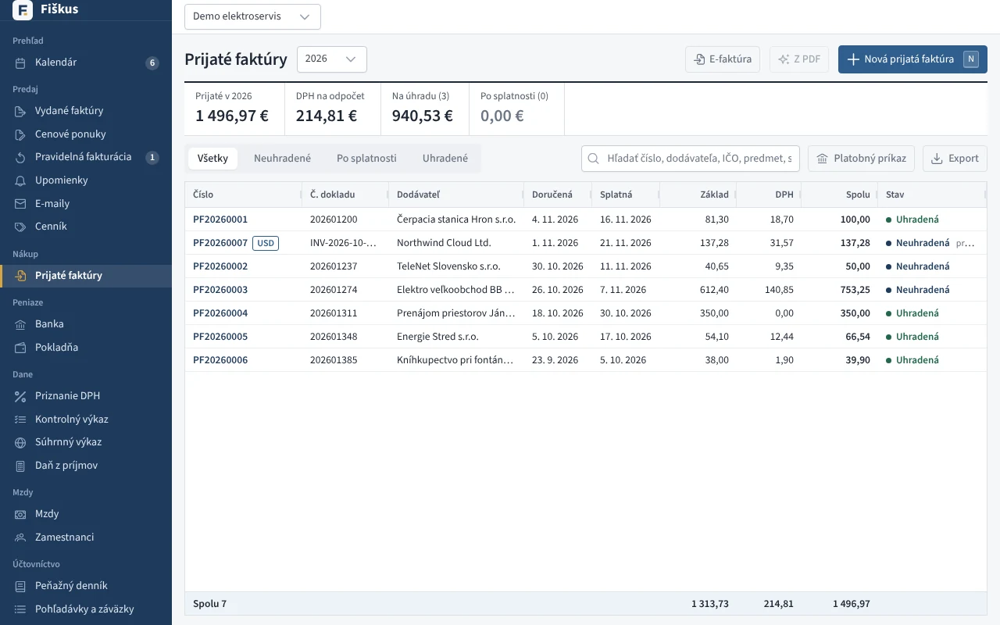
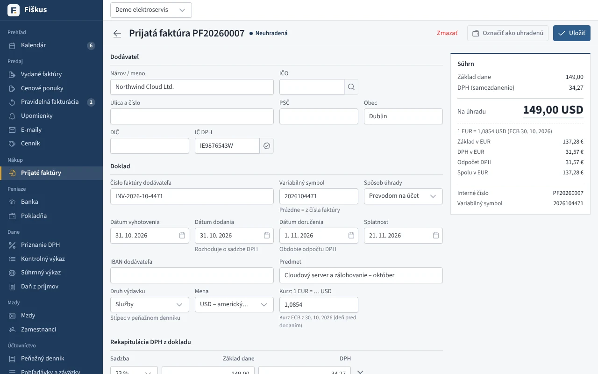
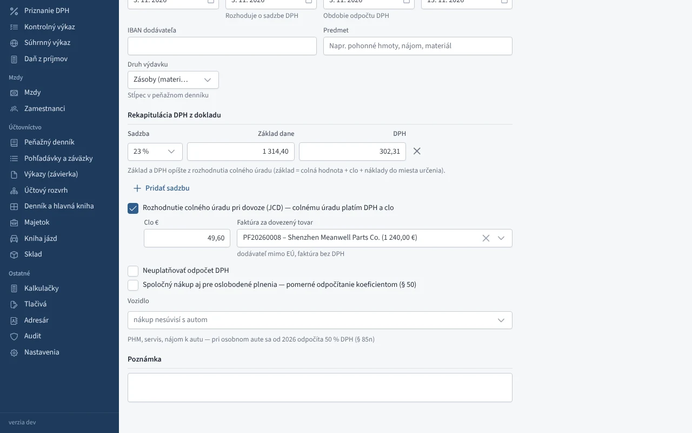

# Nákup

## Prijaté faktúry

Prijatá faktúra sa eviduje z **rekapitulácie DPH dodávateľa** — základ a daň
po sadzbách, tak ako sú na doklade. Pri každej určíte:

*Prijaté faktúry — DPH na odpočet, na úhradu, po splatnosti*

| Voľba | Vplyv |
|---|---|
| s odpočtom / bez odpočtu DPH | riadky 19 a 21 priznania, časť B kontrolného výkazu |
| prenesenie daňovej povinnosti | samozdanenie (riadky 09–10) aj odpočet |
| druh výdavku | stĺpec peňažného denníka, predkontácia v podvojnom účtovníctve |
| vozidlo | odpočet 50 % pri osobnom aute (§ 85n) |

Fiškus upozorní na duplicitu (rovnaký dodávateľ a číslo), eviduje úhrady
a k faktúre sa dá pripojiť súbor (PDF, fotka).

:::tip[Vyťaženie z PDF alebo fotky]
S kľúčom Claude API (Nastavenia → Prístup pre AI) Fiškus prečíta dodávateľa,
čísla a rekapituláciu DPH z PDF alebo fotky. **AI iba navrhuje** —
údaje skontrolujete a uložíte sami.
:::

## Bločky a pokladničné doklady

Bloček z eKasy je zjednodušená faktúra. Najrýchlejšie ho zapíšete
[odfotením QR kódu v mobile](../mobil/index.md): údaje (dodávateľ, položky,
DPH) sa doplnia z Finančnej správy a vznikne uhradený prijatý doklad
s fotkou.

## Zvláštne prípady

*Prijatá faktúra v cudzej mene s kurzom ECB a samozdanením*

- **Pomerné odpočítanie DPH (§ 50)** — predbežný a ročný koeficient,
  vysporiadanie v poslednom období roka.
- **Dovoz z tretej krajiny** s DPH zaplatenou colnému úradu.
- **Nadobudnutie tovaru z EÚ** a služby zo zahraničia.
- **Dobropisy od dodávateľov** — oprava odpočtu, riadky C.2.
- **Platobné príkazy** SEPA (pain.001) z neuhradených faktúr pre banku.

### Dovoz z tretej krajiny: clo a DPH colnému úradu

Pri dovoze tovaru z krajiny mimo EÚ (Čína, USA, Spojené kráľovstvo…)
zaevidujte dva doklady:

1. **Faktúru zahraničného dodávateľa** za tovar, bez DPH (sadzba 0 %, druh
   plnenia tovar, mena podľa faktúry). Platí sa dodávateľovi.
2. **Rozhodnutie colného úradu** (JCD) ako ďalšiu prijatú faktúru. Dodávateľ
   je colný úrad, číslo dokladu je číslo rozhodnutia (MRN). Zaškrtnite
   **Rozhodnutie colného úradu pri dovoze** a v rekapitulácii opíšte základ
   a DPH z rozhodnutia: základ je colná hodnota + clo + náklady do miesta
   určenia. Do poľa **Clo** zadajte clo a priraďte faktúru za dovezený tovar.
   Na úhradu colnému úradu je DPH + clo.

DPH z rozhodnutia sa odpočíta v priznaní v r. 18 – 21 a zároveň v r. 22 – 23
(„z toho pri dovoze“). Do kontrolného výkazu sa neuvádza. V peňažnom denníku
je úhrada colnému úradu výdavok (clo) a zaplatená DPH. V podvojnom
účtovníctve sa rozhodnutie zaúčtuje predkontáciou **FP-CLO**:
clo MD 501 (alebo **FP-CLO-SKLAD** MD 131 pri tovare na sklad), DPH MD 343,
spolu D 379. Úhrada z banky je **B-COLNY** 379 / 221.

*Rozhodnutie colného úradu: základ a DPH z rozhodnutia, clo, faktúra za tovar*

:::info[Clo je súčasť obstarávacej ceny]
Clo a ďalšie náklady súvisiace s obstaraním (doprava, poistenie) patria do
obstarávacej ceny tovaru. Faktúru dopravcu zaevidujte ako bežnú prijatú
faktúru s rovnakým druhom výdavku (zásoby).
:::
