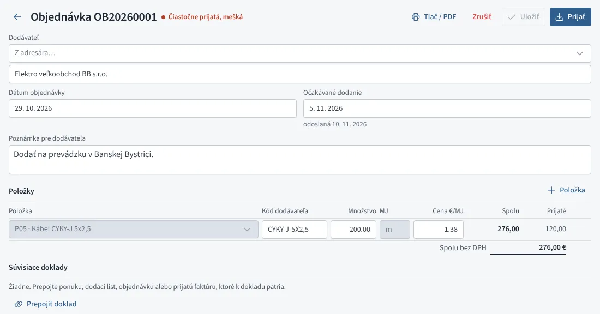
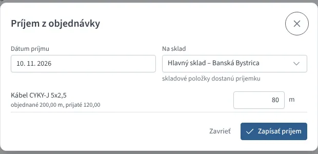
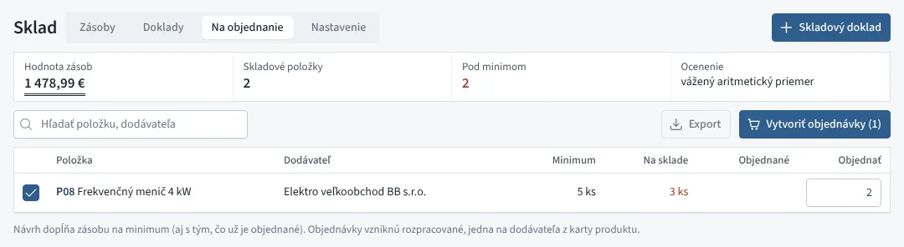

# Objednávky dodávateľom

Objednávky nájdete v menu **Nákup → Objednávky**. Objednávka má dodávateľa,
položky s nákupnou cenou bez DPH a stav:

| Stav | Význam |
|---|---|
| Rozpracovaná | ešte ste ju neposlali, dá sa zmazať |
| Odoslaná | čaká sa na dodanie |
| Čiastočne prijatá | časť prišla, zvyšok sa čaká |
| Prijatá | prišlo všetko |
| Zrušená | zvyšok už nepríde |

Ak očakávané dodanie prešlo a objednávka je ešte otvorená, je označená
červeno ako **mešká**.

*Objednávka dodávateľovi*

## Nová objednávka

1. Tlačidlo **Nová objednávka** (alebo kláves <kbd>N</kbd>).
2. Dodávateľa vyberte z adresára alebo napíšte jeho názov.
3. Pridajte položky. Položka z **cenníka** doplní kód u dodávateľa
   a poslednú nákupnú cenu z karty produktu. Iný tovar zadáte názvom.
4. Uložte. Objednávka dostane číslo (OB20260001…).

Tlačidlom **E-mail** pošlete objednávku dodávateľovi s PDF v prílohe;
adresa sa doplní z adresára. Rozpracovaná objednávka sa odoslaním
označí ako **odoslaná**. Text správy (aj s požadovaným termínom dodania)
upravíte v **E-maily → Nastavenie → Texty správ** (záložka *Objednávky*).

Tlačidlom **Tlač / PDF** objednávku vytlačíte alebo uložíte ako PDF;
ak ju pošlete inak, označte ju tlačidlom **Odoslaná**.

## Príjem na sklad

Keď tovar príde, kliknite na **Prijať**. Fiškus navrhne zvyšné množstvá;
prepíšte ich, ak prišla iba časť. Zvoľte dátum a sklad.

- Položky vedené na sklade dostanú **príjemku** v nákupnej cene
  z objednávky a cena sa zapíše do cenníka ako posledná nákupná.
- Položky mimo skladu sa iba označia ako prijaté.
- Objednávka prejde do stavu *čiastočne prijatá* alebo *prijatá*.

Prijatú položku nemožno z objednávky odstrániť ani znížiť pod prijaté
množstvo. Ak zvyšok nepríde, objednávku **zrušte**.

*Príjem z objednávky*

## Na objednanie

V **Sklad → Na objednanie** (alebo tlačidlom v zozname objednávok) sú
skladové položky, ktorých stav na všetkých skladoch spolu s tým, čo už
je objednané, a po odpočítaní tovaru rezervovaného pre
[prijaté objednávky](../predaj/prijate-objednavky.md) klesol pod
**minimálnu zásobu**. Fiškus navrhne množstvo na doplnenie do minima
(zaokrúhlené nahor na celé jednotky). Položka bez minima sa ukáže, keď
rezervácie prevyšujú stav.

Označte položky, upravte množstvá a kliknite na **Vytvoriť objednávky**.
Vznikne rozpracovaná objednávka pre každého dodávateľa z karty produktu;
dodávateľa Fiškus nájde v adresári podľa názvu.

*Na objednanie podľa minimálnych zásob*

Minimálnu zásobu nastavíte pri skladovej položke v **Sklad → Nastavenie**,
dodávateľa a kód u dodávateľa na [karte produktu](../sklad/karta-produktu.md).

## Prepojenia

Objednávku môžete v časti **Súvisiace doklady** prepojiť so
[zákazkou](../predaj/zakazky.md), prijatou faktúrou dodávateľa alebo
dodacím listom. Príjemka z objednávky nesie jej číslo.
