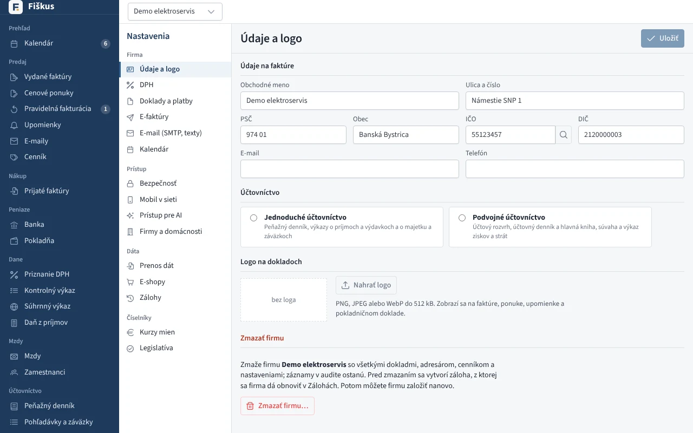
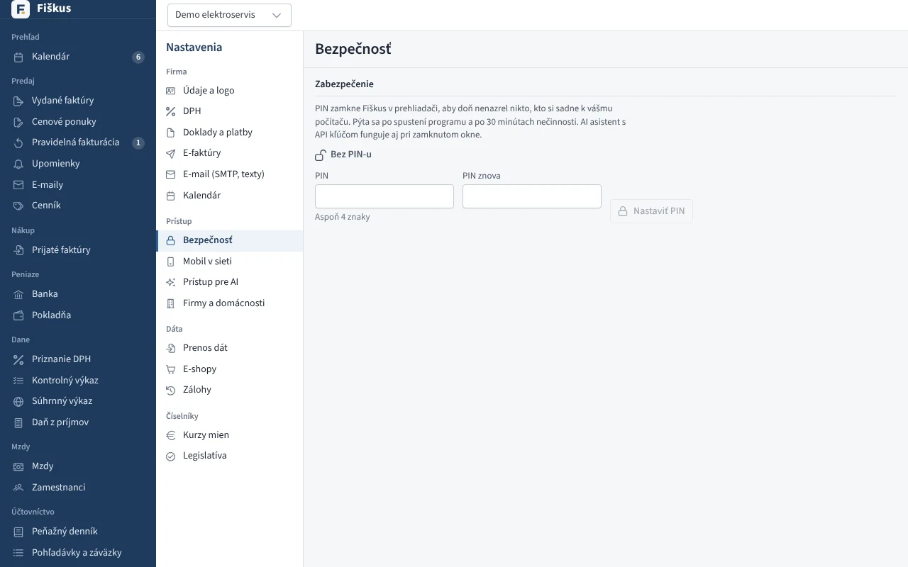
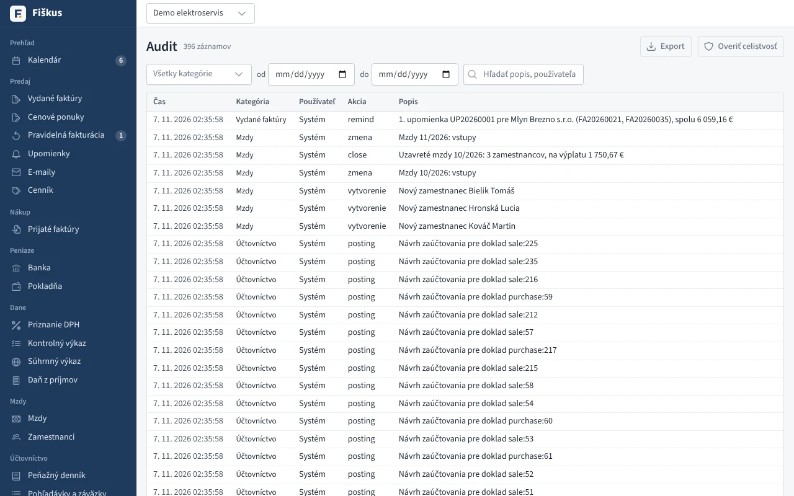
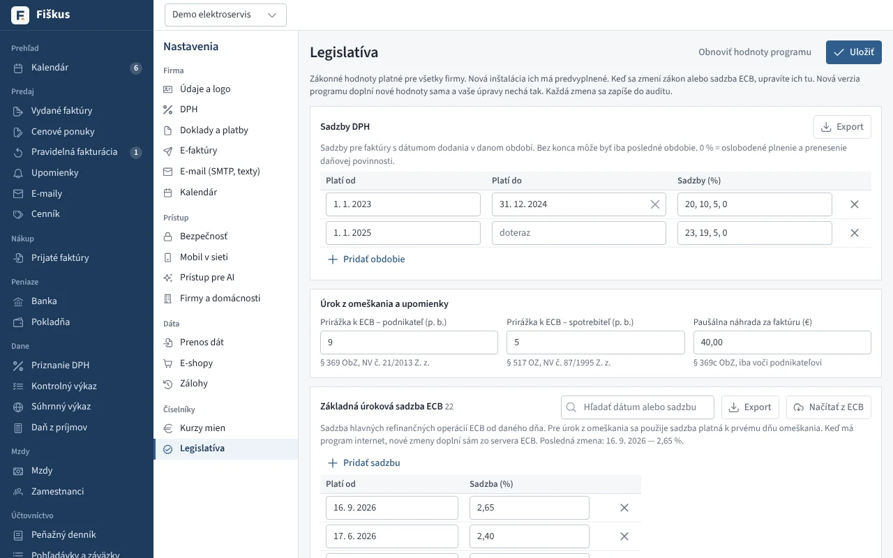
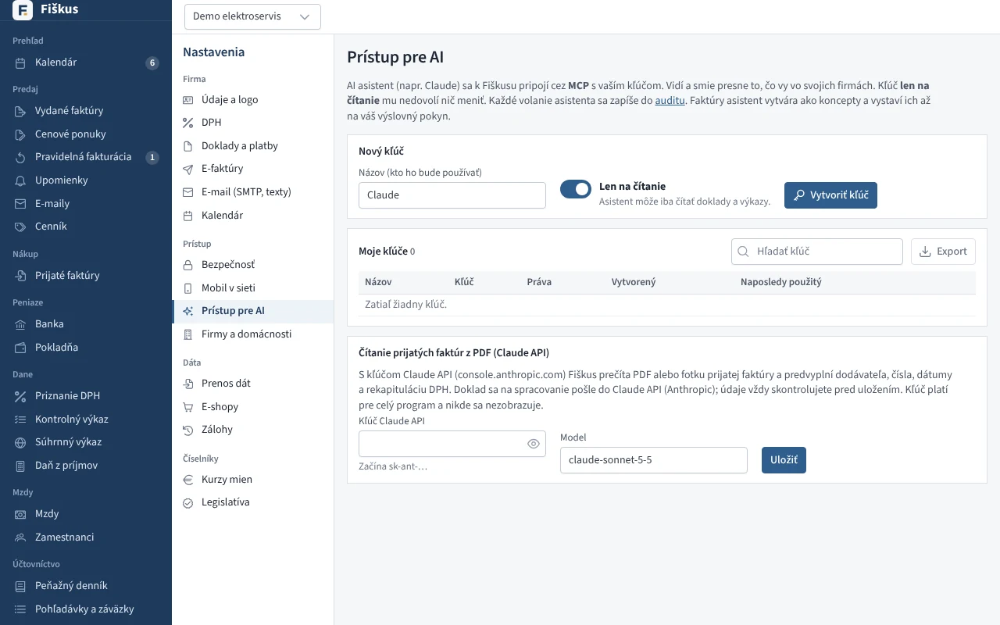

# Nastavenia a bezpečnosť

*Nastavenia: firma, prístup, dáta a číselníky*

## Používatelia a roly (server)

Roly sa prideľujú pre každú firmu zvlášť. Práva kontroluje server pri každej
požiadavke; rozhranie nepovolené akcie iba skryje.

*Bezpečnosť: PIN a zamknutie programu*

| Rola | Smie |
|---|---|
| Správca | všetko vrátane používateľov, nastavení firmy a záloh |
| Účtovník | všetky doklady, nákup, DPH, výkazy a audit |
| Fakturant | vydané faktúry, dobropisy a adresár |
| Zákazník | klient kancelárie — prezerá svoje doklady a výkazy |
| Len čítanie | prezerá doklady bez možnosti zmien |

Na serveri je **dvojfázové overenie povinné** (aplikácia v telefóne, 10
záložných kódov). Desktop sa dá zamknúť PIN-om.

## Audit

Každá zmena: kto, kedy, odkiaľ (rozhranie, API, AI asistent), čo a ako to
vyzeralo predtým. Záznamy tvoria reťazec s odtlačkami, takže dodatočná
úprava sa prezradí.

*Audit — kto, kedy a čo zmenil*

## Zálohy

Automaticky pri štarte, každých 24 hodín a pri ukončení. Záloha sa overí,
zašifruje (AES-256-GCM), znova dešifruje a porovná. Rotácia: 7 denných,
4 týždenné, 12 mesačných. Kópia môže ísť aj do cloudu (WebDAV, S3).
Obnova sa naplánuje a prebehne pri ďalšom spustení.

## Legislatíva

Hodnoty, ktoré sa menia so zákonom, nie sú natvrdo v programe: obdobia
sadzieb DPH, sadzby ECB, prirážky úroku z omeškania, paušálna náhrada, dni
pracovného pokoja. Nová verzia doplní nové riadky a vaše úpravy nechá.

*Legislatíva: sadzby DPH, úroky z omeškania, sadzby ECB*

## AI asistent (MCP)

Fiškus má zabudovaný MCP server, ku ktorému sa pripojí Claude alebo iný
asistent. Asistent má práva svojho používateľa, kľúč môže byť iba na
čítanie a každé volanie je v audite. **DPH, súčty a limity počíta Fiškus**,
asistent iba zadáva údaje; vystavenie faktúry robí iba na výslovný pokyn.
Návod na pripojenie je v [README](https://github.com/palo-krnac/Fiscus#ai-asistent-mcp).

*Prístup pre AI: kľúče pre AI asistenta a čítanie dokladov*

!!! danger "Tajné údaje sa nevracajú"
    Heslo k SMTP, kľúče API, tokeny e-shopov, heslo záloh ani tajomstvá 2FA
    sa po uložení cez rozhranie ani API nikdy neukážu a nezapíšu do auditu.
