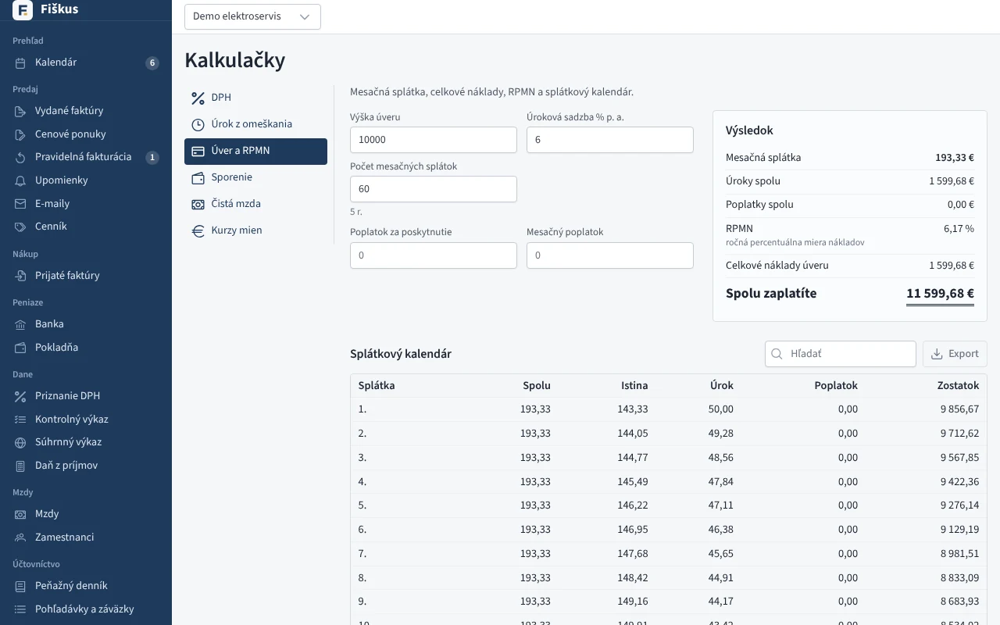
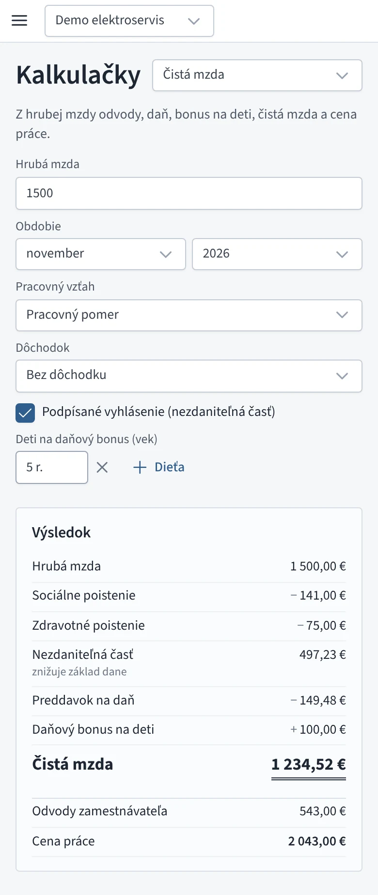

# Kalkulačky

Kalkulačky sú v menu **Ostatné → Kalkulačky**. Fungujú aj bez založenej
firmy — v nainštalovanom programe aj vo Fiškuse v prehliadači
([app.fiskus.online/kalkulacky](https://app.fiskus.online/kalkulacky)).
Nič neukladajú. Výsledok sa prepočíta hneď, ako zmeníte údaj.

*Úver: mesačná splátka, celkové náklady, RPMN a splátkový kalendár*

| Kalkulačka | Čo vypočíta |
|---|---|
| **DPH** | Zo sumy bez DPH sumu s DPH a naopak, so sadzbami platnými dnes. DPH sa zaokrúhľuje rovnako ako na faktúre. |
| **Úrok z omeškania** | Dni omeškania, zákonnú sadzbu a úrok z dlžnej sumy. Medzi podnikateľmi aj paušálnu náhradu 40 € za faktúru. |
| **Úver a RPMN** | Anuitnú mesačnú splátku, úroky, poplatky, celkové náklady, RPMN a splátkový kalendár. |
| **Sporenie** | Zostatok pri počiatočnom a mesačnom vklade, úroky pred zdanením aj po ňom a prehľad po rokoch. |
| **Čistá mzda** | Z hrubej mzdy odvody zamestnanca, preddavok na daň, daňový bonus na deti, čistú mzdu a cenu práce. |
| **Kurzy mien** | Prepočet medzi eurom a cudzou menou referenčným kurzom ECB k dátumu. |

## Úrok z omeškania

Sadzba je **základná úroková sadzba ECB platná k prvému dňu omeškania**,
zvýšená o prirážku. Medzi podnikateľmi platí prirážka podľa § 369
Obchodného zákonníka, pri občanoch podľa § 517 Občianskeho zákonníka.
Sadzba sa počas celého omeškania nemení. Pri dohodnutej sadzbe vyberte
**Dohodnutá sadzba** a zadajte ju v % ročne.

Úrok sa počíta za každý deň od prvého dňa po splatnosti do dňa úhrady
vrátane. Každý kalendárny rok sa delí počtom svojich dní. Sadzby ECB a
prirážky sú v **Nastavenia → Legislatíva** a rovnaké hodnoty používajú
upomienky.

## Úver a RPMN

Splátka je anuitná: každý mesiac rovnaká, úrok sa počíta zo zostatku a
posledná splátka doplatí zvyšok po zaokrúhlení. **RPMN** (ročná
percentuálna miera nákladov) zahŕňa úroky aj poplatky. Je to ročná sadzba,
pri ktorej sa vyplatená suma (úver mínus poplatok za poskytnutie) rovná
súčasnej hodnote všetkých splátok s mesačnými poplatkami. Splátkový
kalendár môžete prehľadávať a exportovať do Excelu alebo CSV.

## Sporenie

Mesačný vklad sa pripíše na začiatku každého mesiaca. Úrok sa pripisuje
mesačne a z každého pripísaného úroku sa zrazí daň (banka zráža 19 %).

## Čistá mzda

Počíta sa rovnako ako modul [Mzdy](../mzdy/index.md), s odvodmi a
nezdaniteľnou časťou za zvolený rok a mesiac. Pri deťoch zadajte vek. Bonus
sa určí podľa veku v danom mesiaci.

{ width="320" }
*Čistá mzda na mobile*

## Kurzy mien

Prepočet používa kurz ECB vyhlásený v zvolený deň, a ak v ten deň kurz
vyhlásený nebol, posledný pred ním. Kurzy sťahuje nainštalovaný program
(**Nastavenia → Kurzy mien**). Ak kurz k dátumu chýba, kalkulačka na to
upozorní.
