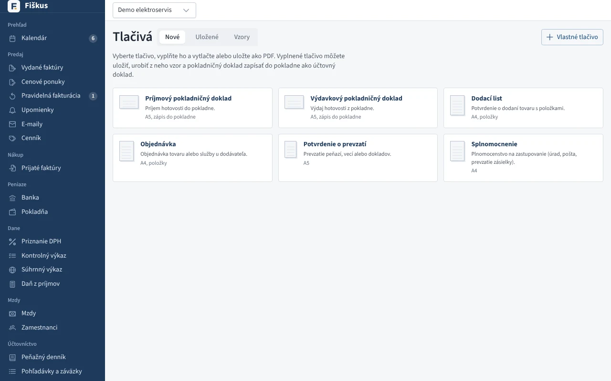
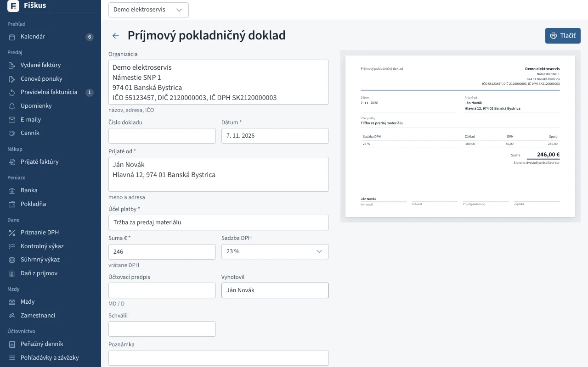
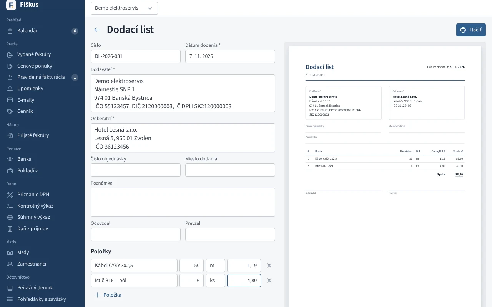

# Tlačivá

Tlačivá sú v menu **Ostatné → Tlačivá**. Vyberiete tlačivo, vyplníte ho a
vpravo hneď vidíte, ako bude vyzerať na papieri. **Tlačiť** otvorí dialóg
tlače, kde ho môžete vytlačiť alebo uložiť ako PDF. Vytlačí sa iba hárok
tlačiva v skutočnej veľkosti (pokladničný doklad na A5 na šírku, ostatné
na A4 alebo A5).

*Výber tlačiva*

| Tlačivo | Na čo |
|---|---|
| **Príjmový pokladničný doklad** | Príjem hotovosti. Suma s DPH, základ a daň dopočíta Fiškus, sumu napíše aj slovom. |
| **Výdavkový pokladničný doklad** | Výdaj hotovosti, rovnako ako príjmový. |
| **Dodací list** | Dodávateľ, odberateľ, položky s množstvom a cenou, podpisy pri odovzdaní. |
| **Objednávka** | Objednávka u dodávateľa s položkami a termínom dodania. |
| **Potvrdenie o prevzatí** | Prevzatie peňazí, vecí alebo dokladov. |
| **Splnomocnenie** | Plnomocenstvo na zastupovanie (úrad, pošta, prevzatie zásielky). |

## Bez firmy

Tlačivá fungujú aj bez založenej firmy: v nainštalovanom programe aj vo
Fiškuse v prehliadači ([app.fiskus.online/tlaciva](https://app.fiskus.online/tlaciva)).
Vtedy sa nič neukladá. Tlačivo vyplníte, vytlačíte alebo uložíte ako PDF.
Prázdne tlačivo môžete vytlačiť aj na ručné vyplnenie.

## Vo firme: uloženie, vzory a pokladňa

Vo firme je hlavička (**Organizácia**, **Dodávateľ** …) predvyplnená údajmi
firmy a pribudnú tlačidlá:

- **Uložiť**: tlačivo sa uloží do zoznamu **Uložené**. Zoznam má hľadanie
  (názov, odberateľ, číslo, položka) a export do Excelu alebo CSV.
- **Uložiť ako vzor**: hodnoty sa uložia do zoznamu **Vzory**. **Použiť**
  vytvorí nové tlačivo s hodnotami vzoru, dnešným dátumom a bez čísla.
  Vzor sa hodí na opakované doklady, napríklad dennú tržbu, dodací list
  stálemu odberateľovi alebo splnomocnenie na poštu.
- **Zapísať do pokladne** (pokladničné doklady): tlačivo sa zapíše do
  **Pokladne** ako účtovný doklad. Dostane číslo z radu pokladne (PPD…, VPD…)
  a pri platiteľovi DPH aj DPH v zvolenej sadzbe. Zostatok pokladne nesmie
  klesnúť pod nulu. Ak máte viac pokladní, vyberiete, do ktorej sa zapíše.

*Príjmový pokladničný doklad: vľavo vyplnenie, vpravo hárok na tlač*

Tlačivo zapísané do pokladne sa už nemení ani nemaže. Opravuje sa v
**Pokladni** stornom a novým dokladom, rovnako ako každý pokladničný doklad.
Vytlačiť ho môžete kedykoľvek.

## Vlastné tlačivá

Tlačidlom **Vlastné tlačivo** si firma zadá vlastné tlačivo: názov, papier
(A4 alebo A5), či má tabuľku položiek, a polia. Každé pole má názov, druh
(text, viac riadkov, suma, číslo, dátum), môže byť povinné a cez celú
šírku. Poradie polí zmeníte šípkami. Vlastné tlačivo sa vytlačí ako list
s nadpisom, poliami, položkami so súčtom a podpismi.

*Dodací list: položky so súčtom, ktorý počíta Fiškus*

Vlastné tlačivo upravíte ikonou ceruzky pri ňom. Zmazať ho môžete, až keď
podľa neho nie je uložené žiadne tlačivo ani vzor.
