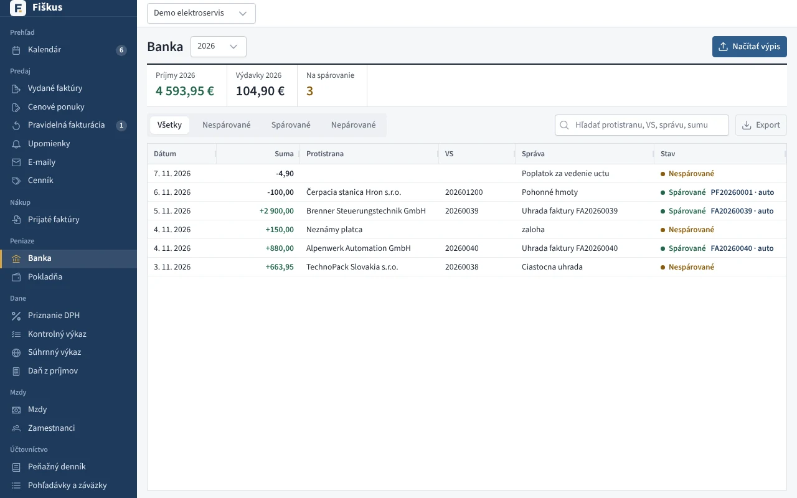
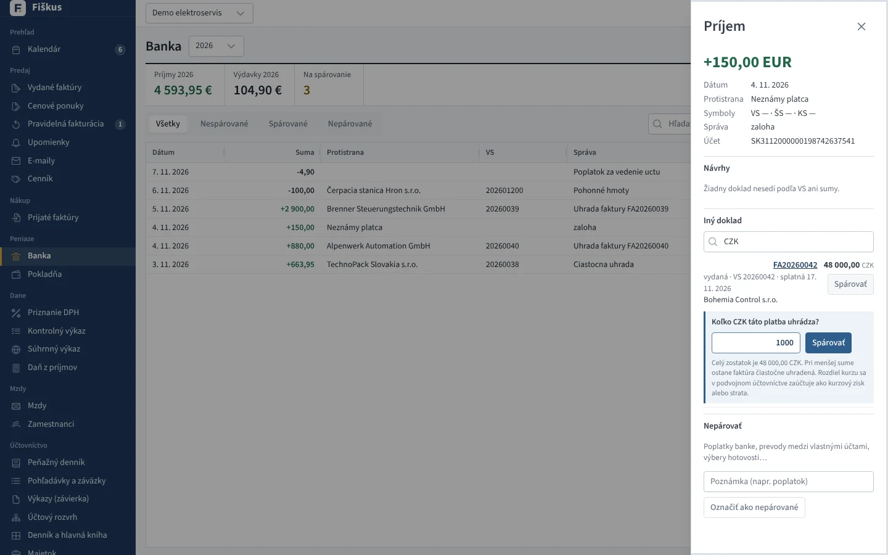
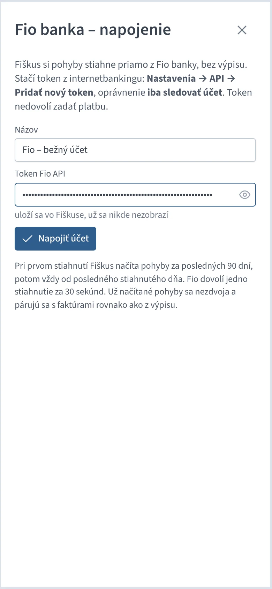
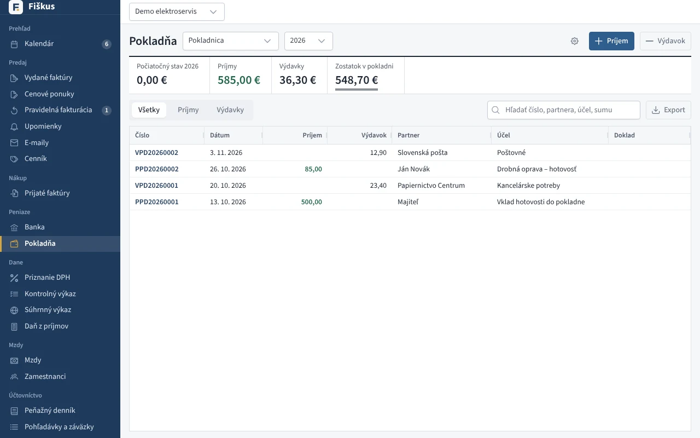
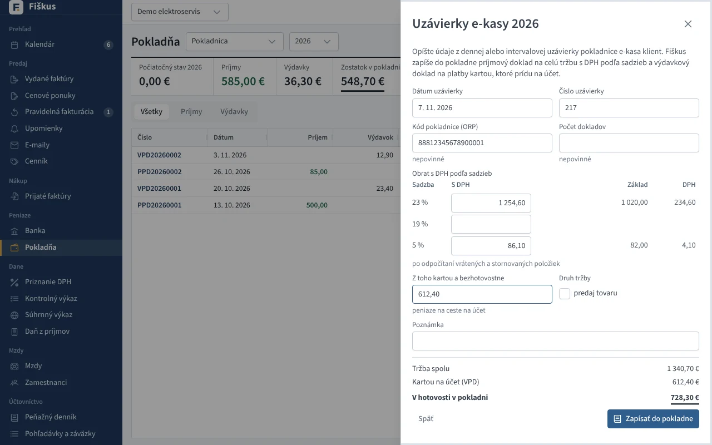

# Peniaze

## Banka

*Bankový výpis spárovaný s faktúrami podľa VS a sumy*

| Formát výpisu | Poznámka |
|---|---|
| camt.053 (XML) | štandard slovenských bánk |
| GPC | starší formát (ABO) |
| CSV, Excel | stĺpce podľa hlavičky |

Po načítaní Fiškus **spáruje platby s faktúrami** podľa variabilného symbolu
a sumy. Čo si nie je istý, ponúkne ako návrh; zvyšok spárujete ručne alebo
necháte ako nepárovaný pohyb (poplatky, vklady), ktorý sa v peňažnom
denníku zapíše ručne. Čiastočné úhrady sa sčítajú.

**Faktúra v cudzej mene z eurového účtu.** Pri ručnom párovaní eurovej
platby sa v zozname „Iný doklad“ ponúknu aj faktúry v cudzej mene (hľadať sa
dá aj podľa meny, napr. CZK). Fiškus sa opýta, koľko v mene faktúry platba
uhrádza — predvolený je celý zostatok, pri menšej sume ostane faktúra
čiastočne uhradená a čaká na ďalšiu platbu. V podvojnom účtovníctve sa pri
každej platbe odpíše z účtu 311 pomerná časť sumy faktúry v eurách
(posledná platba zvyšok) a rozdiel je kurzový zisk (663) alebo strata (563).

*Eurová platba k faktúre v CZK: koľko korún uhrádza*

### Fio banka priamo, bez výpisu

Fio banka dovolí čítať pohyby na účte cez svoje API. V Banke kliknite na
**Napojiť Fio** a vložte token z internetbankingu Fio (**Nastavenia → API →
Pridať nový token**, oprávnenie *iba sledovať účet*). Takýto token nedovolí
zadať platbu. Potom stačí tlačidlo **Stiahnuť z Fio**: nové pohyby sa načítajú
a spárujú s faktúrami rovnako ako z výpisu.

- Pri prvom stiahnutí sa načítajú pohyby za posledných 90 dní, potom vždy od
  posledného stiahnutého dňa. Už načítané pohyby sa nezdvoja.
- Fio dovolí jedno stiahnutie za 30 sekúnd; Fiškus skoršie volanie ani
  nepošle.
- Token sa po uložení už nikde nezobrazí (ani v audite či chybových
  hláseniach). Zmeniť ho môžete úpravou napojenia, zrušiť napojenie
  tlačidlom koša; stiahnuté pohyby zostanú.
- Viac účtov vo Fio (napr. eurový a dolárový) = viac tokenov, každý ako
  samostatné napojenie.
- Vo verzii v prehliadači napojenie nie je, banka nedovolí volanie
  z webovej stránky. Použite výpis.

*Napojenie na Fio banku tokenom*

Ostatné slovenské banky sprístupňujú pohyby iba licencovaným
poskytovateľom (PSD2), preto sa u nich načítava výpis.

:::info[Prečo párovanie, a nie odškrtnutie „uhradené“]
Úhrada je udalosť s dátumom a sumou. Z nej sa počíta peňažný denník,
kurzový rozdiel aj stav pohľadávok k ľubovoľnému dňu. Faktúra s odškrtnutým
políčkom by nevedela povedať, kedy a koľko prišlo.
:::

## Pokladňa

Príjmové a výdavkové pokladničné doklady (PPD, VPD) s tlačou a sumou slovom.
Fiškus nedovolí, aby zostatok pokladne klesol pod nulu. Pokladničný doklad
môže uhradiť faktúru v hotovosti.

*Pokladňa — príjmové a výdavkové doklady, zostatok*

- **DPH na pokladničných dokladoch** — bloček ako zjednodušená faktúra
  (odpočet, KV B.3.1/B.3.2 podľa limitu 3 000 €), tržba z e-kasy (KV D.1).
- **Viac pokladní** — každá má vlastný zostatok a rad dokladov.
- **Pokladňa v cudzej mene** — kurz ECB ku dňu dokladu.

### Uzávierky e-kasy

Tržby z pokladnice e-kasa klient netreba zapisovať po bločkoch. V Pokladni
kliknite na **Uzávierky e-kasy → Nová uzávierka** a opíšte údaje z dennej
alebo intervalovej uzávierky: dátum, číslo uzávierky, kód pokladnice (ORP),
obrat s DPH v každej sadzbe (po odpočítaní vrátených a stornovaných položiek)
a koľko z toho zákazníci zaplatili kartou. Základ a DPH v každej sadzbe aj
hotovosť dopočíta Fiškus hneď pri písaní.

**Zapísať do pokladne** vytvorí dva doklady:

- **PPD na celú tržbu** s DPH podľa sadzieb. Daň ide do priznania DPH
  (r. 03 až 06) a do kontrolného výkazu v časti D.1. V peňažnom denníku je
  to príjem z predaja tovaru (d1) alebo služieb (d2) podľa políčka **predaj
  tovaru**, v podvojnom účtovníctve 211 / 604 alebo 602 a 343.
- **VPD na platby kartou**: tieto peniaze nie sú v pokladni, sú na ceste na
  účet. V peňažnom denníku sú priebežná položka (c), v podvojnom účtovníctve
  261 / 211.

Keď banka platby z terminálu pripíše na účet, Fiškus ich v bankovom výpise
spozná podľa textu (platby kartou, terminál, Global Payments, SumUp…) a
zaúčtuje ich ako peniaze na ceste (221 / 261, v peňažnom denníku c), nie ako
druhú tržbu. Ak banka pripíše sumu po odpočítaní poplatku, rozdiel
rozpíšte v peňažnom denníku ako výdavok na služby.

Neplatiteľ DPH zadá iba celú tržbu, bez sadzieb. Tá istá uzávierka (rovnaké
číslo a ORP) sa nedá zapísať dvakrát. Doklady uzávierky sa nedajú stornovať
jednotlivo. Stornuje sa celá uzávierka a s ňou oba doklady, potom ju
môžete zapísať znova.

*Uzávierka e-kasy: obrat podľa sadzieb, platby kartou, hotovosť v pokladni*
