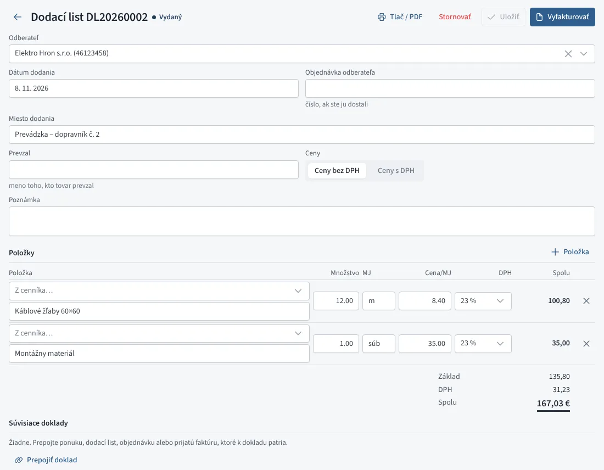

# Dodacie listy

Dodací list potvrdzuje, že ste zákazníkovi odovzdali tovar alebo prácu.
Nie je to daňový doklad: ceny na ňom slúžia na neskoršiu faktúru, ktorá
môže byť aj **zberná** z viacerých dodacích listov. Nájdete ich v menu
**Predaj → Dodacie listy**.

| Stav | Význam |
|---|---|
| Koncept | ešte nemá číslo, dá sa zmazať |
| Vydaný | má číslo (DL20260001), tovar zo skladu je vydaný |
| Vyfakturovaný | je na faktúre, už sa nemení |
| Stornovaný | zrušený, tovar sa vrátil na sklad |

*Dodací list*

## Nový dodací list

Dodací list založíte:

- tlačidlom **Nový dodací list** (alebo klávesom <kbd>N</kbd>),
- z [cenovej ponuky](ponuky.md) tlačidlom **Dodací list** – prevezme
  odberateľa a položky a prepojí sa s ponukou,
- zo [zákazky](zakazky.md) tlačidlom **Dodací list** – priradí sa k nej.

Vyplňte odberateľa (z adresára alebo názvom), dátum dodania, miesto
dodania, prípadne číslo objednávky odberateľa a meno toho, kto tovar
prevzal. Položky pridáte z cenníka alebo popisom.

## Vydanie a sklad

Tlačidlo **Vydať** pridelí dodaciemu listu číslo. Položky z cenníka vedené
na sklade sa v tej chvíli **vydajú zo skladu** výdajkou dodacieho listu.
Vydaný dodací list môžete ešte upraviť (číslo ostane a výdajka sa upraví
s ním). Ak sa dodávka neuskutočnila, dodací list **stornujte** – tovar sa
vráti na sklad.

## Tlač

**Tlač / PDF** pripraví dodací list na A4 s miestom na podpis *Odovzdal*
a *Prevzal*. Prepínačom **s cenami** zvolíte, či sa ceny vytlačia.

## Faktúra z dodacích listov

- Z jedného dodacieho listu: tlačidlo **Vyfakturovať** v detaile.
- Zberná faktúra: v zozname (záložka *Na fakturáciu*) označte vydané
  dodacie listy **toho istého odberateľa** a kliknite na **Vyfakturovať
  vybrané**.

Vznikne koncept faktúry so všetkými položkami, dátumom dodania podľa
posledného dodacieho listu a textom „Podľa dodacích listov …“. Dodacie
listy sa označia ako vyfakturované a prepoja sa s faktúrou. Tovar
z faktúry sa zo skladu nevydáva znova – vydal ho už dodací list.

Ak koncept faktúry zmažete alebo faktúru stornujete, dodacie listy sa
vrátia do stavu *vydaný* a môžete ich vyfakturovať znova.
