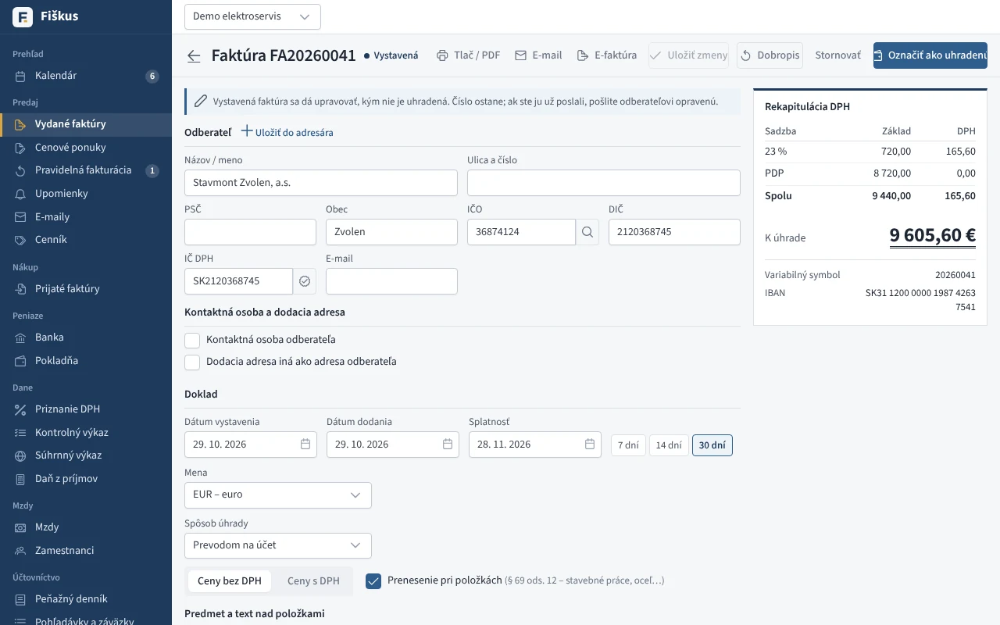
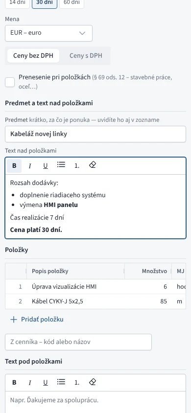
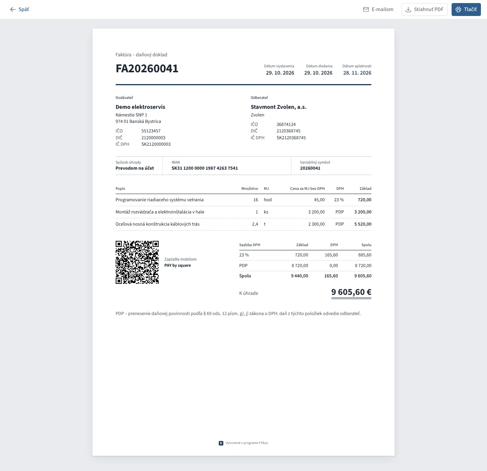
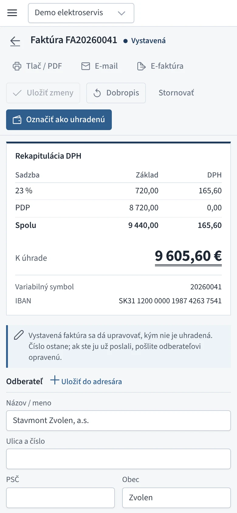
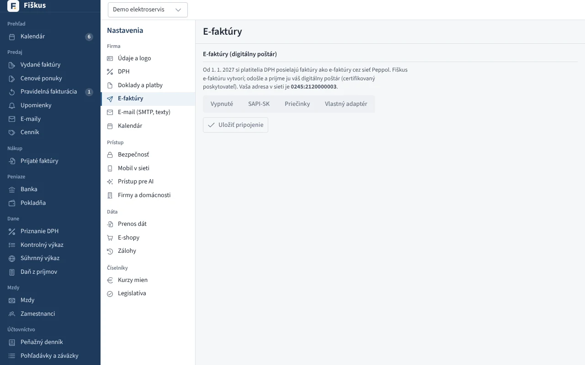

# Faktúry a dobropisy

## Životný cyklus

*Vystavená faktúra s prenesením daňovej povinnosti pri položkách a rekapituláciou DPH*

| Stav | Čo sa deje |
|---|---|
| Koncept | Ľubovoľne sa mení, nemá číslo, nikde sa nepočíta. |
| Vystavená | Dostane číslo z radu (bez dier), ide do DPH a kontrolného výkazu, vznikne pohľadávka. |
| Uhradená | Úhradu priradí banka, pokladňa alebo ručný zápis; čiastočné úhrady sa sčítajú. |
| Stornovaná | Iba ak ešte nikam nevstúpila; inak sa opravuje dobropisom. |

Sumy, DPH a rekapituláciu podľa sadzieb počíta server pri každej zmene
riadku — rozhranie iba ukazuje výsledok. Konečná suma je dvojito podčiarknutá
ako v účtovnej knihe.

## Texty nad položkami a pod nimi

Predmet, text nad položkami a text pod položkami má každý doklad: faktúra,
zálohová faktúra, cenová ponuka aj pravidelná faktúra. Texty nad a pod
položkami sa dajú formátovať tlačidlami nad poľom (alebo Ctrl+B, Ctrl+I,
Ctrl+U):

- **tučné**, *kurzíva*, podčiarknuté,
- odrážky a číslovaný zoznam,
- odseky a zalomenie riadku.

Text skopírovaný z Wordu, Excelu, e-mailu alebo webu sa pri vložení
vyčistí: odrážky, číslovanie, tučné a kurzíva ostanú, písma, farby a
veľkosti zmiznú, tabuľka sa zmení na riadky. Na doklade (PDF aj tlač) je
text rovnako. E-faktúra a e-mail nesú obyčajný text s odrážkami „•“.

*Formátovaný text nad položkami ponuky*

## Úprava vystavenej faktúry

Vystavenú faktúru možno opraviť (číslo ostane, zmena ide do auditu), kým:

- nie je uhradená,
- nie je priznaná v DPH (po 25. dni po skončení obdobia),
- nebola odoslaná ako e-faktúra,
- nemá dobropis.

Potom sa opravuje **iba dobropisom**.

:::info[Prečo také prísne pravidlo]
Faktúru, ktorú už odberateľ zaúčtoval alebo ktorá je v podanom priznaní,
nemožno potichu prepísať — u odberateľa by ostala pôvodná verzia a v priznaní
iné číslo než v knihách. Dobropis je stopa, ktorú vidia obe strany aj
daňový úrad.
:::

## Dobropis

Dobropis (opravná faktúra) môže byť na celú faktúru alebo na časť položiek.
Fiškus stráži, aby dobropisy neprekročili pôvodnú faktúru, a použije sadzby
DPH platné k pôvodnému dodaniu. Dobropis k neuhradenej faktúre sa s ňou
započíta.

## Platba a odoslanie

*Faktúra na tlač a do PDF s QR kódom PAY by square*

*Tá istá faktúra na mobile*

- **PAY by square** — QR kód na tlači aj v PDF, z hotových súm faktúry.
- **E-mail** — PDF zo servera cez vlastný SMTP, história odoslaných e-mailov.
- **E-faktúra** — UBL 2.1 (Peppol BIS Billing 3.0), adresa `0245:DIČ`;
  odoslanie cez digitálneho poštára. Prijaté e-faktúry sa načítajú ako
  nákup.

## E-faktúra a digitálny poštár

Od 1. 1. 2027 si platitelia DPH posielajú faktúry cez sieť Peppol. Fiškus
e-faktúru vytvorí, odošle a prijme ju certifikovaný **digitálny poštár**.
Pripojenie je v **Nastaveniach → E-faktúry**:

*Nastavenia → E-faktúry: pripojenie na digitálneho poštára*

| Spôsob | Kedy |
|---|---|
| SAPI-SK | odporúčané — národné rozhranie, ktoré spoločne podporujú slovenskí poštári (ePošťák, Verteco…); zadáte adresu API, Client ID a Client secret |
| Priečinky | poštár má aplikáciu, ktorá synchronizuje priečinky na počítači |
| Vlastný adaptér | iný poštár cez prekladový program |

Tlačidlo **Overiť spojenie** skontroluje prihlásenie a schránku firmy bez
odoslania čohokoľvek. Ten istý doklad odoslaný dvakrát (napríklad po výpadku
spojenia) poštár nezdvojí.

| Krok | Čo sa deje |
|---|---|
| Kontrola | ak ju poštár ponúka, skontroluje e-faktúru podľa pravidiel EN 16931 a Peppol; neplatná sa **neodošle** a pri faktúre uvidíte porušené pravidlá |
| Odoslanie | poštár potvrdí prevzatie |
| Doručenie | Fiškus sa poštára pýta každú hodinu (30 dní); pri faktúre vidíte „doručená 4. 1. 2027“, alebo použite **Zistiť stav** |
| Nedoručenie | príjemca nie je v sieti Peppol alebo doručenie zlyhalo — zapíše sa do auditu a faktúru treba poslať inak |

:::warning[Výber poštára na portáli finančnej správy]
Okrem nastavenia vo Fiškuse si poštára musíte vybrať aj na portáli finančnej
správy (výber digitálneho poštára). Bez toho vám e-faktúry nebudú doručované.
:::

## Zahraničie a osobitné režimy

| Prípad | Ako to Fiškus rieši |
|---|---|
| Faktúra v cudzej mene | kurz ECB, DPH v eurách |
| Tovar a služby do EÚ | súhrnný výkaz, riadky 13–15 priznania |
| Tuzemské prenesenie (§ 69 ods. 12) | druhy a) až j), hranica 5 000 €, A.2 kontrolného výkazu |
| Trojstranný obchod (§ 45) | text na faktúre, SV kód 1 |
