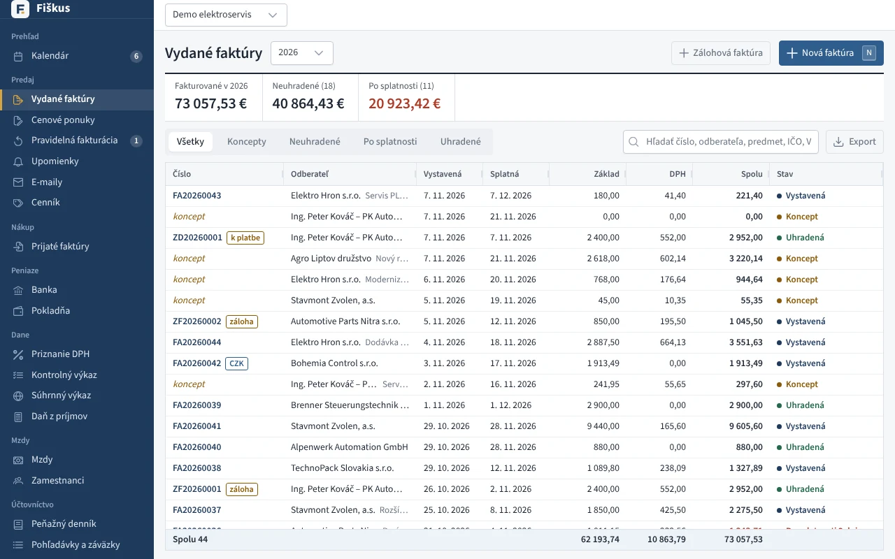

# Predaj


*Zoznam vydaných faktúr so súčtami a stavmi*


```cards
- title: Faktúry a dobropisy
  href: ./faktury.md
  icon: file-text
  text: Od konceptu po úhradu, dobropis, QR platba, e-mail, e-faktúra.
- title: Zálohy
  href: ./zalohy.md
  icon: clock
  text: Zálohová faktúra, daňový doklad k platbe a vyúčtovanie.
- title: Cenové ponuky a pravidelná fakturácia
  href: ./ponuky.md
  icon: edit
  text: Ponuka s prijatím cez odkaz, faktúry, ktoré sa vystavia samy.
- title: Prijaté objednávky
  href: ./prijate-objednavky.md
  icon: inbox
  text: Objednávka od zákazníka, rezervácia tovaru, dodanie po častiach.
- title: Dodacie listy
  href: ./dodacie-listy.md
  icon: package
  text: Dodací list z ponuky či zákazky, výdaj zo skladu, zberná faktúra.
- title: Zákazky
  href: ./zakazky.md
  icon: briefcase
  text: Ponuky, faktúry a náklady jednej práce pokope, zisk a marža.
- title: Upomienky
  href: ./upomienky.md
  icon: bell
  text: Tri stupne, zákonný úrok z omeškania a paušálna náhrada.
- title: Cenník
  href: ./cennik.md
  icon: tag
  text: Opakované položky faktúr; skladové položky majú kartu produktu.
```
