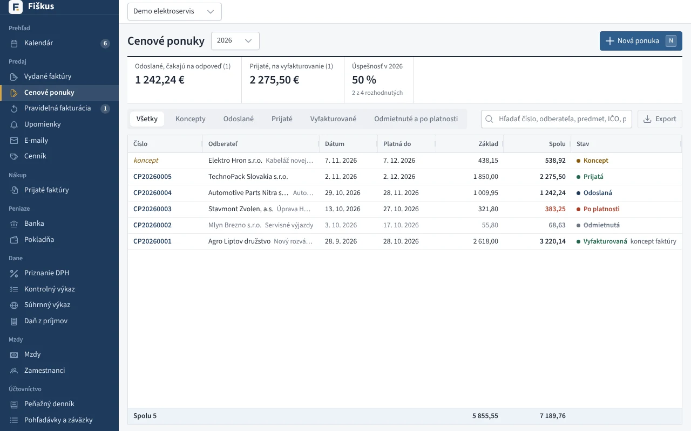
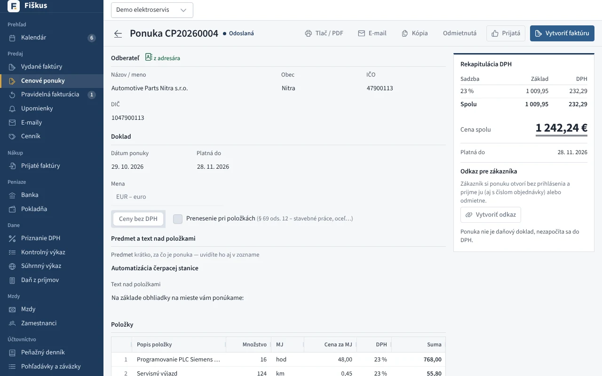
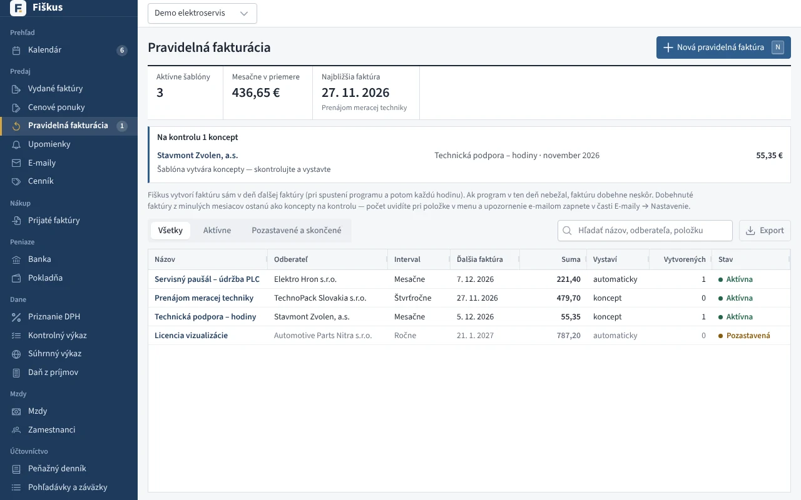

# Cenové ponuky a pravidelná fakturácia

## Cenová ponuka

Ponuka má vlastný číselný rad (CP), platnosť a stavy *odoslaná*, *prijatá*,
*odmietnutá*, *po platnosti*. Do DPH sa nezapočíta. Na serveri s verejnou
adresou ju zákazník prijme alebo odmietne cez tajný odkaz a môže pripísať
číslo svojej objednávky. Prijatá ponuka sa jedným klikom zmení na koncept
faktúry.

Vystavenú ponuku (aj prijatú či odmietnutú) môžete upravovať, kým nie je
vyfakturovaná: zmeny uložíte tlačidlom *Uložiť zmeny*, číslo a stav ostanú
a úprava sa zapíše do auditu. Ak ste ponuku už poslali, pošlite zákazníkovi
upravenú. Novú verziu s novým číslom vytvorí *Kópia*. Samotné číslo
zmeníte tlačidlom *Zmeniť číslo*.

Ak je ponuka vyfakturovaná faktúrou, ktorá už existuje (vystavili ste ju
mimo ponuky alebo ste ponuky preniesli z iného programu), použite *Už
vyfakturovaná…* a vyberte faktúru. Ponuka dostane stav *vyfakturovaná* a
faktúra sa ukáže v jej súvisiacich dokladoch.

*Cenové ponuky so stavmi a úspešnosťou*

*Ponuka s odkazom pre zákazníka a vytvorením faktúry*

## Pravidelná fakturácia

Šablóna faktúry s intervalom (mesačne, štvrťročne, polročne, ročne) a
koncom. V texte možno použiť `{obdobie}`, `{mesiac}`, `{rok}` a
`{minule_obdobie}`. Fiškus faktúru vytvorí a vystaví sám — pri štarte a
každú hodinu — a ak chcete, aj ju pošle e-mailom.

*Šablóny pravidelných faktúr a koncepty na kontrolu*

!!! note "Dobehnuté obdobia"
    Ak program dlhšie nebežal, staršie obdobia sa vytvoria ako koncepty na
    kontrolu, nie ako vystavené faktúry. Odznak v menu ukáže, koľko ich čaká.
