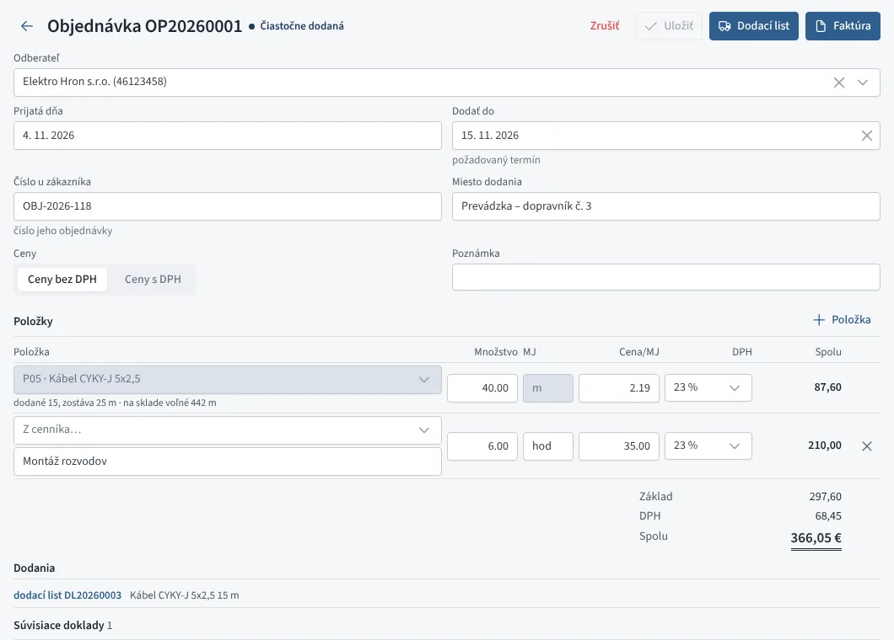

# Prijaté objednávky

Prijatú objednávku zapíšete, keď si zákazník u vás niečo objedná.
Kým nie je vybavená, Fiškus pre ňu **rezervuje tovar na sklade**, takže
vidíte, čo je naozaj voľné. Dodávať môžete po častiach dodacími listami
alebo faktúrami a objednávka si pamätá, čo už bolo dodané. Objednávky
nájdete v menu **Predaj → Prijaté objednávky**.

| Stav | Význam |
|---|---|
| Prijatá | zapísaná, zatiaľ nič nedodané |
| Čiastočne dodaná | časť je už na dodacom liste alebo faktúre |
| Vybavená | dodané je všetko |
| Zrušená | zákazník objednávku zrušil, rezervácia sa uvoľnila |

Objednávka, ktorá čaká na dodanie a má prekročený požadovaný termín, je
v zozname označená **po termíne**.

*Prijatá objednávka*

## Nová objednávka

Objednávku zapíšete tlačidlom **Nová objednávka** (alebo klávesom
<kbd>N</kbd>), alebo z cenovej ponuky, ktorú zákazník prijal:
**Viac → Prijatá objednávka**. Vtedy sa prevezme odberateľ, položky aj
ceny a ponuka sa s objednávkou prepojí.

Vyplňte odberateľa, dátum prijatia, **Dodať do** (požadovaný termín),
číslo objednávky u zákazníka a miesto dodania. Položky pridáte z cenníka
alebo ako voľný text. Číslo objednávky (OP20260001) sa pridelí hneď pri
uložení.

Upravovať sa dá, kým objednávka čaká na dodanie. Položku, ktorá už bola
čiastočne dodaná, nemožno odstrániť a jej množstvo nemožno znížiť pod
dodané.

## Rezervácia tovaru

Skladová položka z cenníka sa rezervuje v množstve, ktoré ešte zostáva
dodať. Rezervácia sa prejaví:

- **pri riadku objednávky**: koľko je na sklade voľné po rezerváciách
  iných objednávok, prípadne koľko chýba,
- v **Sklade** pri položke: rezervované a voľné množstvo (na hlavnom
  sklade, z ktorého sa vydáva),
- v **Na objednanie**: návrh počíta aj s rezervovaným tovarom, takže
  objednáte to, čo potrebujete na vybavenie objednávok
  (pozri [Objednávky dodávateľom](../nakup/objednavky.md#na-objednanie)).

Rezervácia sa uvoľní dodaním alebo zrušením objednávky.

## Dodanie

Tlačidlami **Dodací list** alebo **Faktúra** sa otvorí výber množstiev.
Fiškus navrhne celý zvyšok; upravte, koľko dodávate teraz, a vznikne
koncept dodacieho listu alebo faktúry s odberateľom, cenami, miestom
dodania a číslom objednávky zákazníka. Koncept skontrolujte a vystavte.

- Tovar zo skladu sa vydá až [vydaním dodacieho listu](dodacie-listy.md)
  alebo vystavením faktúry.
- Zvyšok ostane v objednávke na ďalšie dodanie.
- Dodané doklady sú v časti **Dodania** a v súvisiacich dokladoch.

Ak koncept zmažete alebo doklad stornujete, množstvá sa vrátia do
objednávky na dodanie a tovar sa znova rezervuje.

## Zrušenie a zmazanie

**Zrušiť** možno objednávku, ktorá čaká na dodanie; už vytvorené dodacie
listy a faktúry ostanú. Zrušenú objednávku môžete **obnoviť**. Zmazať
sa dá iba objednávka, z ktorej ešte nič nebolo dodané.

## Zoznam

Zoznam má hľadanie (číslo, odberateľ, položka, číslo u zákazníka) a
zobrazenia **Na dodanie**, **Všetky**, **Vybavené** a **Zrušené**.
Kliknutím na **Po termíne** v hlavičke sa zobrazia iba omeškané. Zoznam
po filtri a hľadaní vyexportujete do Excelu alebo CSV.
