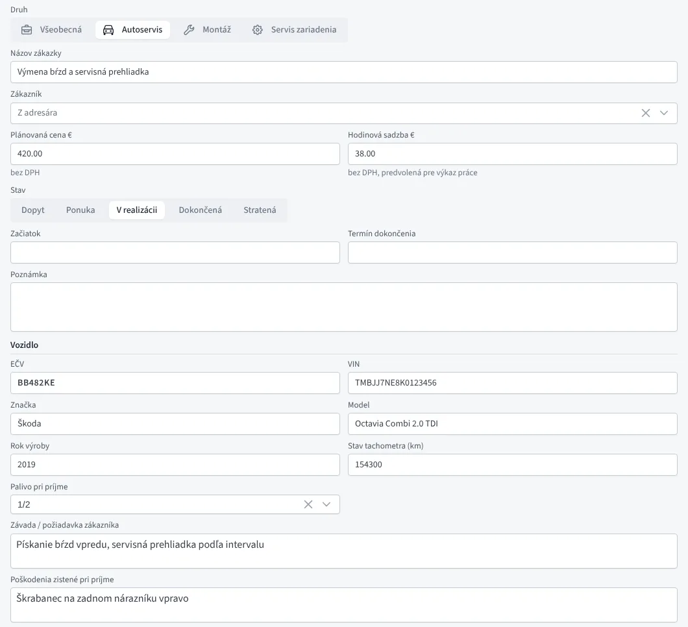
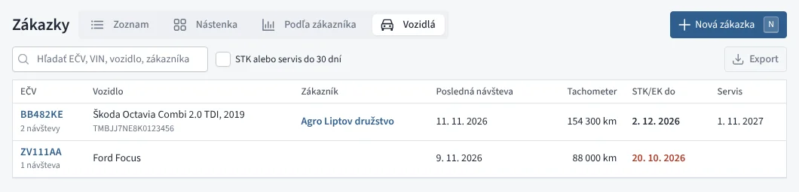
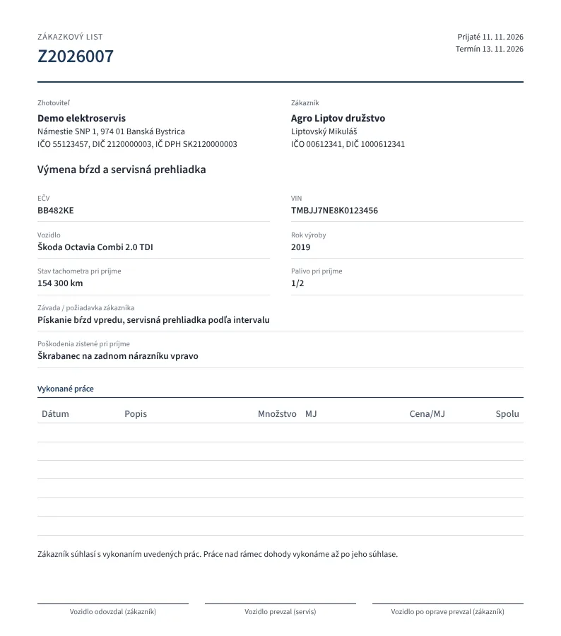
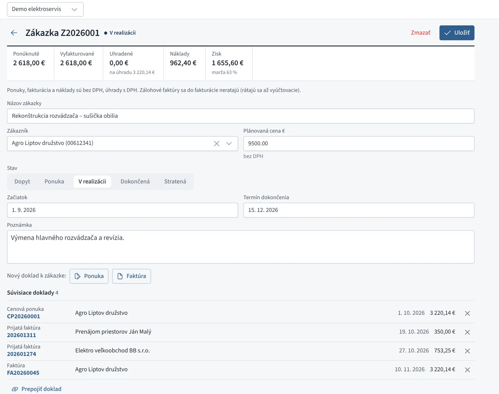
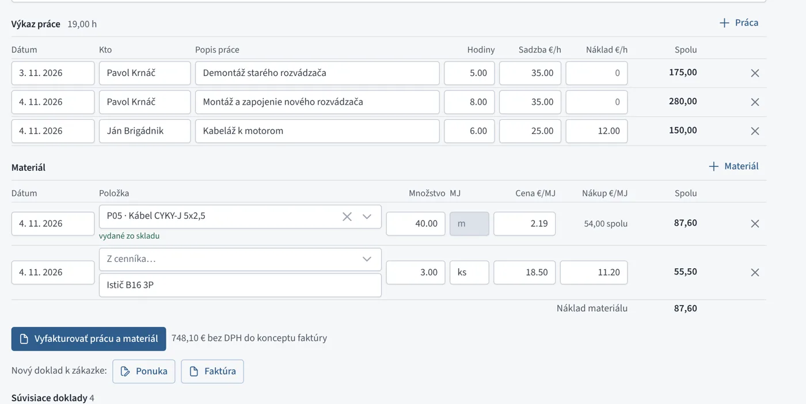
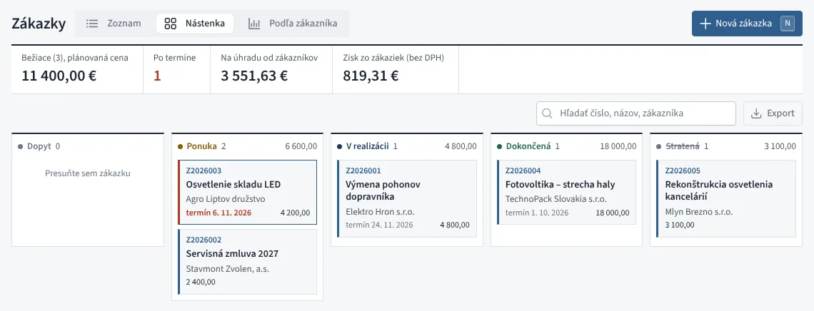
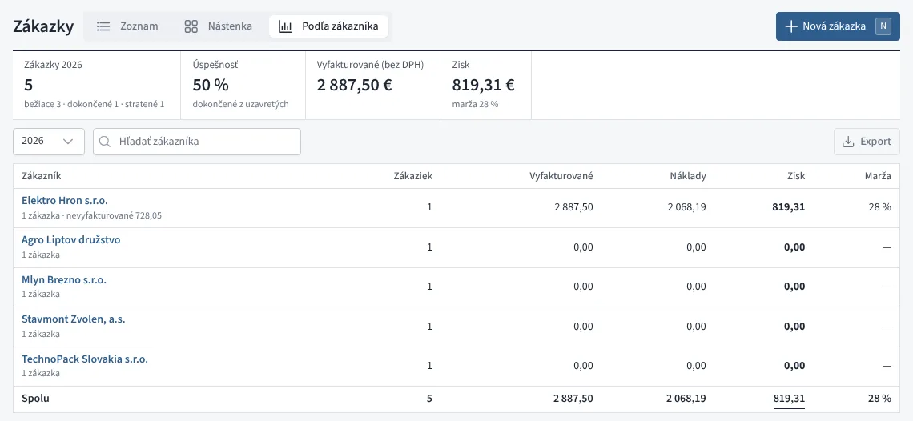
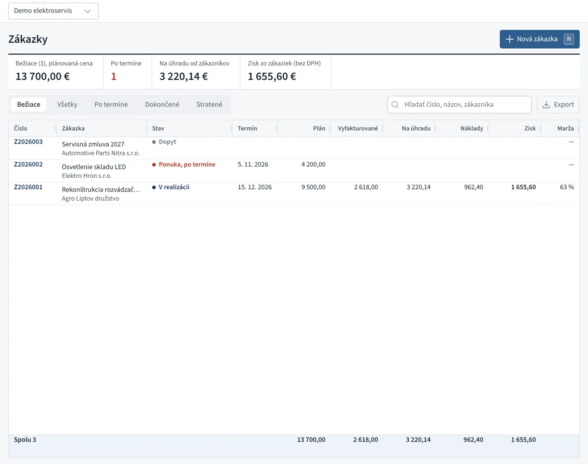
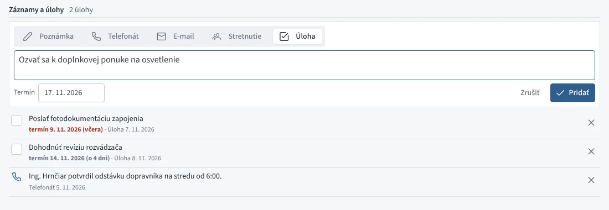

# Zákazky

Zákazka spája všetko, čo patrí k jednej práci pre zákazníka: dopyt,
cenové ponuky, faktúry, dodacie listy aj prijaté faktúry za materiál
a subdodávky. Z prepojených dokladov Fiškus sám spočíta, koľko ste
ponúkli, vyfakturovali, koľko vám zákazník zaplatil, aké boli náklady
a koľko na zákazke zostalo.

Zákazky nájdete v menu **Predaj → Zákazky**.

## Nová zákazka

Tlačidlo *Nová zákazka* (alebo kláves <kbd>N</kbd>) otvorí formulár:

- **Druh** – *Všeobecná*, *Autoservis*, *Montáž* alebo *Servis zariadenia*
  (pozri [Druhy zákaziek](#druhy-zakaziek)).
- **Názov zákazky** – napríklad „Rekonštrukcia rozvádzača – sušička obilia“.
- **Zákazník** – vyberiete z adresára.
- **Plánovaná cena** – čo za zákazku očakávate (u platiteľa DPH bez DPH).
- **Stav** – *Dopyt*, *Ponuka*, *V realizácii*, *Dokončená* alebo *Stratená*.
- **Začiatok** a **Termín dokončenia**.
- **Poznámka**.

Po uložení dostane zákazka číslo z vlastného radu (Z2026001, Z2026002…).
Zákazku založíte aj priamo z kontaktu v adresári tlačidlom *Nová zákazka*.

## Druhy zákaziek

Druh zákazky pridá údaje, ktoré sú pre daný odbor potrebné. Ekonomika,
výkaz práce, materiál, doklady aj fakturácia sú pre všetky druhy rovnaké.
Nová zákazka dostane druh, ktorý ste použili naposledy.

| Druh | Údaje navyše |
|---|---|
| Všeobecná | žiadne |
| Autoservis | **vozidlo**: EČV, VIN, značka, model, rok výroby, stav tachometra a paliva pri príjme, závada či požiadavka zákazníka, poškodenia zistené pri príjme, STK/EK a ďalší servis |
| Montáž | **miesto montáže** (predvyplní sa adresa zákazníka), montážnici, kontakt na mieste, rozsah prác |
| Servis zariadenia | **zariadenie**: druh, výrobca, typ, výrobné číslo, záručná oprava s dátumom kúpy, popis závady, prevzaté príslušenstvo |

*Zákazka autoservisu s údajmi vozidla*

- EČV sa uloží veľkými písmenami bez medzier a pomlčiek (BB-482 KE →
  BB482KE). Pri autoservise treba zadať EČV alebo VIN; VIN má 17 znakov.
- V zozname a na nástenke je pod názvom predmet zákazky: EČV s vozidlom,
  zariadenie s výrobným číslom alebo miesto montáže. Hľadať môžete aj podľa
  EČV, VIN či výrobného čísla.
- Pri vozidle a zariadení sa predmet dostane aj do predmetu faktúry
  z výkazu práce (napr. „Výmena bŕzd – BB482KE Škoda Octavia“).
- Keď zmeníte druh, údaje predchádzajúceho druhu sa pri uložení zahodia.

### Vozidlá

Pri autoservise si Fiškus vozidlá pamätá podľa EČV (bez EČV podľa VIN):

- **Známe vozidlo**: keď v novej zákazke zadáte EČV vozidla, ktoré už
  bolo v servise, doplnia sa VIN, značka, model, rok výroby, termíny
  a zákazník z predchádzajúcich zákaziek. Vyplnené údaje sa neprepíšu.
- **História vozidla**: pod údajmi vozidla sú jeho predchádzajúce
  zákazky s dátumom, stavom tachometra a stavom.
- **STK/EK platí do** a **Ďalší servis**: termíny sa zobrazia
  v [kalendári](../dane/index.md#kalendar-terminov) (druh *Vozidlá*)
  s odkazom na poslednú zákazku vozidla, takže môžete zákazníka včas
  osloviť.
- **Zákazky → Vozidlá** (zobrazenie sa ukáže pri prvej zákazke
  autoservisu): zoznam vozidiel s posledným zákazníkom, poslednou
  návštevou, najvyšším stavom tachometra a termínmi. Termín po lehote je
  červený, termín do 30 dní tučný; prepínač *STK alebo servis do 30 dní*
  ukáže iba vozidlá, ktoré treba osloviť. Zoznam má hľadanie a export.

*Vozidlá zákazníkov s termínmi STK a servisu*

### Tlač zákazky

Tlačidlo v hlavičke zákazky vytlačí (alebo uloží do PDF) tlačivo podľa druhu:

| Druh | Tlačivo | Podpisy |
|---|---|---|
| Autoservis | **zákazkový list** s vozidlom, závadou a poškodeniami pri príjme | vozidlo odovzdal, prevzal servis, po oprave prevzal |
| Montáž | **montážny protokol** s miestom, montážnikmi a rozsahom prác, miesto na výhrady | za zhotoviteľa, dielo prevzal |
| Servis zariadenia | **servisný list** so zariadením, výrobným číslom, zárukou a príslušenstvom | zariadenie odovzdal, prevzal servis, po oprave prevzal |
| Všeobecná | **zákazkový list** | za zhotoviteľa, zákazník |

Na tlačive je výkaz práce a materiál s cenami alebo bez nich (prepínač
*s cenami*) a súčet. Kým výkaz ešte nič neobsahuje (napríklad pri príjme
vozidla), sú na tlačive prázdne riadky na ručné doplnenie prác.

*Zákazkový list autoservisu pri príjme vozidla*

## Doklady k zákazke

V detaile zákazky sú tlačidlá **Nový doklad k zákazke: Ponuka / Faktúra /
Dodací list**. Nový doklad má predvyplneného zákazníka a po uložení sa
k zákazke prepojí sám.

Už existujúce doklady pridáte v časti **Súvisiace doklady** tlačidlom
*Prepojiť doklad* – rovnako ako pri [faktúrach](faktury.md#suvisiace-doklady).
K zákazke tak patria aj prijaté faktúry (náklady) a tlačivá ako dodací
list či preberací protokol. Prepojenie zrušíte krížikom, doklad tým
nezmažete.

*Detail zákazky s ekonomikou a dokladmi*

## Výkaz práce

V časti **Výkaz práce** zapisujete, kto, kedy a koľko hodín na zákazke
pracoval. Tlačidlo *+ Práca* pridá riadok s dnešným dátumom, menom
z predchádzajúceho riadku a **hodinovou sadzbou** zákazky. Mená sa
ponúkajú zo zamestnancov a z doterajších záznamov.

- **Sadzba €/h** je to, čo zákazníkovi fakturujete (u platiteľa DPH bez DPH).
- **Náklad €/h** vyplňte pri práci, ktorá vás niečo stojí (zamestnanec,
  brigádnik, subdodávateľ). Vlastnú prácu nechajte na nule.

## Materiál

V časti **Materiál** zapisujete spotrebovaný materiál:

- **Položka z cenníka** doplní názov, jednotku a predajnú cenu. Ak je
  položka vedená na **sklade**, po uložení sa vydá zo skladu výdajkou
  zákazky (jedna výdajka na deň, mení sa spolu so zákazkou) a náklad sa
  vezme z ocenenia skladu (priemer alebo FIFO).
- **Materiál mimo cenníka** zadáte názvom; nákupnú cenu doplňte, ak ho
  nemáte na prijatej faktúre prepojenej so zákazkou (inak by sa náklad
  zarátal dvakrát).

Výdajku zákazky nemožno upraviť ani zmazať v sklade – materiál meníte
v zákazke. Zmazaním zákazky sa materiál vráti na sklad.

## Faktúra z výkazu

Keď je výkaz uložený, tlačidlo **Vyfakturovať prácu a materiál**
pripraví koncept faktúry pre zákazníka zákazky:

- práca ako hodiny so sadzbou (v popise dátum a meno),
- materiál s množstvom a predajnou cenou,
- dátum dodania podľa posledného záznamu, predmet podľa názvu zákazky.

Faktúra sa k zákazke prepojí sama a zapísané riadky sa označia číslom
faktúry. Vyfakturovanú prácu ani materiál už nemožno zmeniť ani zmazať.
Ak koncept zmažete alebo faktúru stornujete, riadky sa uvoľnia a možno
ich vyfakturovať znova. Materiál na faktúre z výkazu sa zo skladu
nevydáva druhýkrát.

*Výkaz práce a materiál na zákazke*

## Ekonomika zákazky

Hore v detaile je prehľad:

| Údaj | Čo obsahuje |
|---|---|
| Ponúknuté | vystavené, prijaté a vyfakturované cenové ponuky |
| Vyfakturované | vystavené faktúry a dobropisy |
| Uhradené | čo zákazník zaplatil, pod tým suma, ktorá ešte ostáva na úhradu |
| Nevyfakturované | práca a materiál z výkazu, ktoré ešte nie sú na faktúre, a odpracované hodiny |
| Náklady | prijaté faktúry prepojené so zákazkou, náklad práce a materiálu a nákupná cena tovaru zo skladu predaného faktúrami zákazky |
| Zisk | vyfakturované mínus náklady, pod tým marža v percentách |

U platiteľa DPH sú ponuky, fakturácia a náklady **bez DPH**, úhrady s DPH.
Neplatiteľ vidí všetko vrátane DPH. Koncepty sa nerátajú. Zálohové faktúry
sa do fakturácie nerátajú – zaráta sa až vyúčtovacia faktúra, aby suma
nebola dvakrát.

## Zoznam, nástenka a ziskovosť

Hore v Zákazkách prepínate tri zobrazenia (Fiškus si posledné zapamätá):

- **Zoznam** – tabuľka so záložkami a súčtami (nižšie).
- **Nástenka** – stĺpce Dopyt, Ponuka, V realizácii, Dokončená a Stratená
  s kartami zákaziek a súčtom plánovanej ceny. Kartu **presuniete myšou**
  do iného stĺpca a zákazka zmení stav; kliknutím ju otvoríte. Na mobile
  sa stĺpce posúvajú prstom do strany.
- **Podľa zákazníka** – ziskovosť za zvolený rok: počet zákaziek,
  vyfakturované, náklady, zisk a marža pre každého zákazníka, zoradené
  od najziskovejšieho. Hore je **úspešnosť** (koľko z uzavretých zákaziek
  ste dokončili, nie stratili). Zákazka patrí do roka, v ktorom sa
  uzavrela; bežiaca do roka začiatku.

*Nástenka zákaziek*

*Ziskovosť zákaziek podľa zákazníka*

### Zoznam

Zoznam má záložky *Bežiace*, *Všetky*, *Po termíne*, *Dokončené* a
*Stratené*. Bežiaca zákazka, ktorej termín dokončenia už prešiel, je
označená červeno. Hore je súčet plánovanej ceny bežiacich zákaziek, suma
na úhradu od zákazníkov a zisk. Ako každý zoznam vo Fiškuse má aj tento
hľadanie a export do Excelu a CSV. Keď používate aj iné ako všeobecné
zákazky, pribudne výber **druhu** (napr. iba autoservis).

*Zoznam zákaziek*

## Záznamy a úlohy

Pri zákazke, cenovej ponuke aj kontakte v adresári je časť **Záznamy
a úlohy** – jednoduchá história komunikácie so zákazníkom:

- **Záznam** – poznámka, telefonát, e-mail alebo stretnutie (čo sa
  dohodlo, kto volal).
- **Úloha** – čo treba urobiť a do kedy, napríklad *ozvať sa k ponuke*.
  Navrhnutý termín je o týždeň.

Nesplnené úlohy sú hore zoradené podľa termínu, úloha po termíne je
červená. Splnenú úlohu odškrtnete. Úlohy s termínom sú aj v
[kalendári](../dane/index.md#kalendar-terminov) (druh *Úlohy*) a v jeho
odbere do mobilu či Google Kalendára.

Záznam zo zákazky alebo ponuky sa ukáže aj pri kontakte zákazníka,
s odkazom na zákazku či ponuku.

*Záznamy a úlohy pri zákazke*

## Zákazky a doklady pri kontakte

V adresári sa pri kontakte zobrazujú jeho záznamy a úlohy, zákazky
a posledné faktúry a ponuky. Kliknutím ich otvoríte.

!!! note "Zákazka v účtovníctve je niečo iné"
    V podvojnom účtovníctve je ešte analytická *zákazka* v účtovom rozvrhu
    (kód, ktorý sa pridáva k zaúčtovaniu). Tá slúži na rozbor nákladov a
    výnosov v účtovníctve. Zákazky v predaji sú jednoduchá evidencia práce
    pre zákazníka a s účtovaním nesúvisia.
