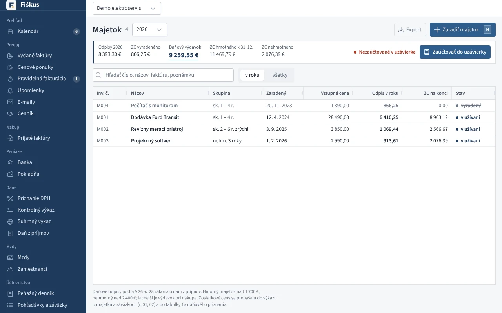
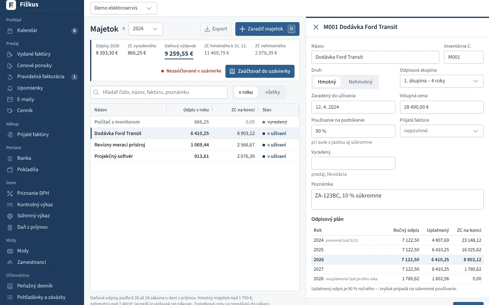
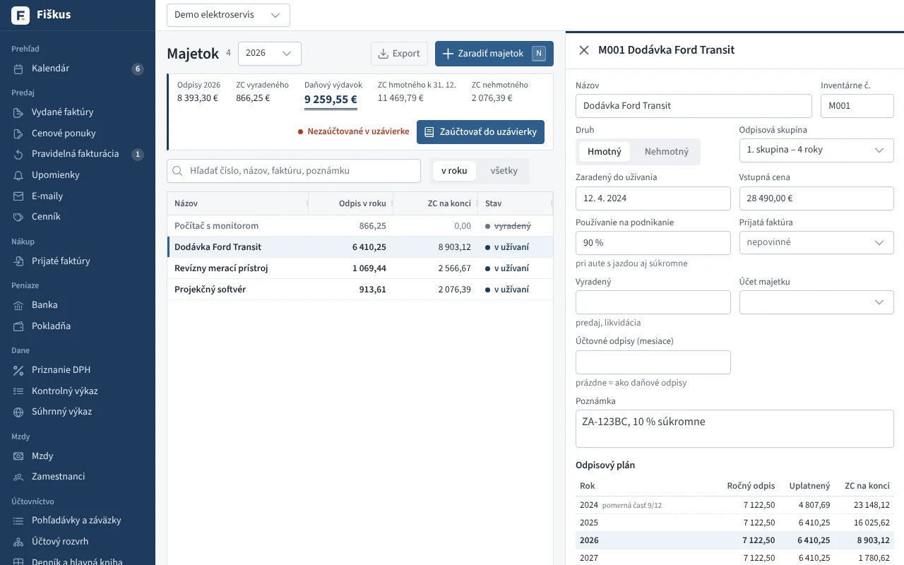
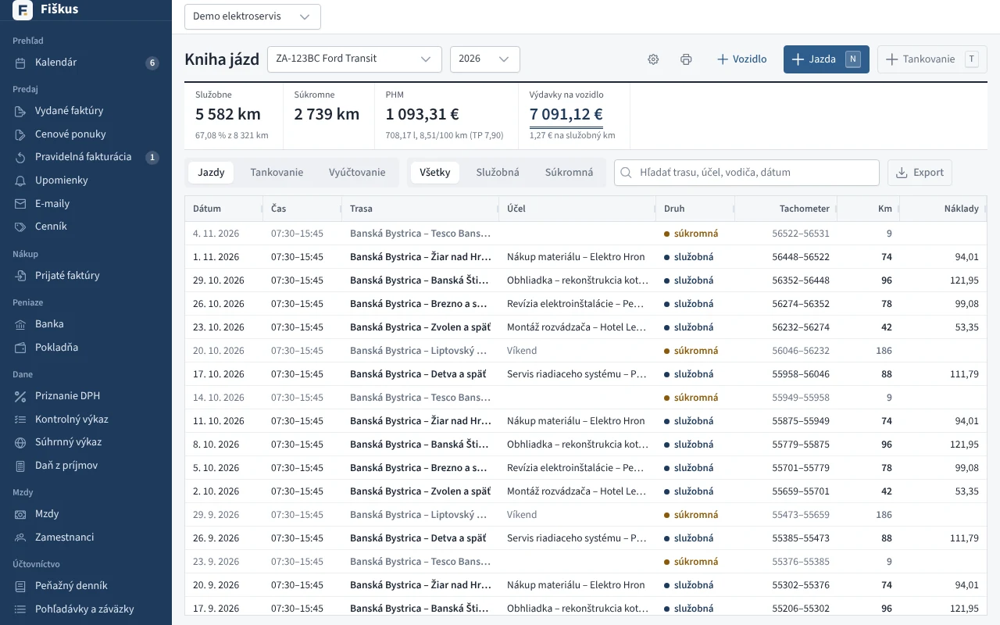

# Majetok a kniha jázd

## Register majetku

Daňové odpisy podľa § 22 – 29 zákona o dani z príjmov:

*Register majetku s daňovými odpismi*

*Karta majetku s odpisovým plánom*

| Voľba | Možnosti |
|---|---|
| odpisová skupina | 0 – 6 |
| metóda | rovnomerná, zrýchlená |
| rok zaradenia | pomerná časť odpisu |
| podiel na podnikaní | percento |
| vyradenie | predaj, likvidácia — zostatková cena do výdavkov |

Odpisový plán sa ukáže na celé obdobie. Odpisy roka prenesiete jedným
tlačidlom do uzávierky (stĺpec e6) a zostatkové ceny do výkazu o majetku.

## Účtovné odpisy (podvojné účtovníctvo)

V podvojnom účtovníctve má každá položka majetku aj **účet** (predvolene
013 softvér, 021 stavby, 022 samostatné hnuteľné veci) a **dobu účtovného
odpisovania v mesiacoch** podľa vášho odpisového plánu. Účtovné odpisy sú
rovnomerné mesačné — od mesiaca po zaradení, naposledy za mesiac pred
vyradením. Bez zadanej doby sú rovnaké ako daňové (bez krátenia podielom
na podnikaní).

*Účet majetku a doba účtovného odpisovania v podvojnom účtovníctve*

V **Účtovnej knihe → Účtovné odpisy** sa za rok zaúčtuje jeden interný
doklad k 31. 12.:

| Operácia | MD | D |
|---|---|---|
| Odpis | 551 | 08x (07x) |
| Zostatková cena predaného majetku | 541 | 08x |
| Zostatková cena pri likvidácii, škode, vklade | 551 | 08x |
| Vyradenie v obstarávacej cene | 08x | 02x (01x) |

Opakované zaúčtovanie doklad nahradí. Rozdiel medzi účtovnými a daňovými
odpismi Fiškus ukáže pri položke aj v súčte — kladný sa v daňovom
priznaní pripočíta k výsledku hospodárenia, záporný sa odpočíta.

## Kniha jázd

Vozidlá (v obchodnom majetku, prenajaté, súkromné), jazdy so stavom
tachometra, účelom a vodičom, tankovanie z bločkov a prijatých faktúr.
Ročné vyúčtovanie: spotreba podľa knihy jázd s limitom z technického
preukazu, alebo paušál 80 % / 50 %; cestovné náhrady za súkromné auto.

*Kniha jázd — služobné a súkromné jazdy, tankovanie, výdavky na vozidlo*

!!! note "DPH pri vozidlách od roku 2026"
    Pri osobnom aute (M1, L1e, L3e) sa z nákupov odpočíta 50 % DPH. Plný
    odpočet je pri výlučnom podnikateľskom použití (VIN, kniha jázd, dátum
    oznámenia). Vozidlo na prijatej faktúre nastaví odpočet samo.
