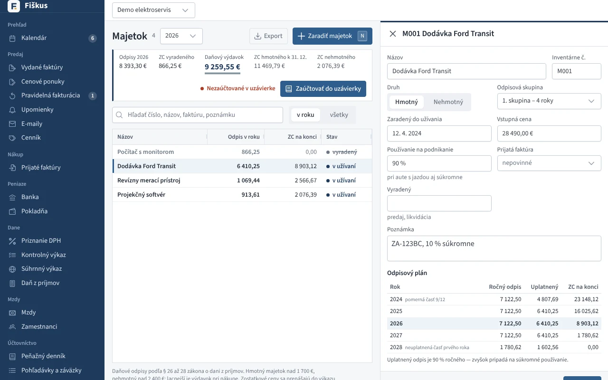
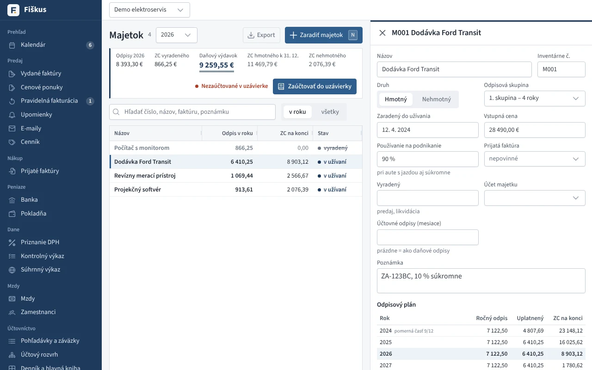

# Majetok a kniha jázd

## Register majetku

Daňové odpisy podľa § 22 – 29 zákona o dani z príjmov:

*Register majetku s daňovými odpismi*

*Karta majetku s odpisovým plánom*

| Voľba | Možnosti |
|---|---|
| odpisová skupina | 0 – 6 |
| metóda | rovnomerná, zrýchlená |
| rok zaradenia | pomerná časť odpisu |
| podiel na podnikaní | percento |
| vyradenie | predaj, likvidácia — zostatková cena do výdavkov |

Odpisový plán sa ukáže na celé obdobie. Odpisy roka prenesiete jedným
tlačidlom do uzávierky (stĺpec e6) a zostatkové ceny do výkazu o majetku.

## Účtovné odpisy (podvojné účtovníctvo)

V podvojnom účtovníctve má každá položka majetku aj **účet** (predvolene
013 softvér, 021 stavby, 022 samostatné hnuteľné veci) a **dobu účtovného
odpisovania v mesiacoch** podľa vášho odpisového plánu. Účtovné odpisy sú
rovnomerné mesačné — od mesiaca po zaradení, naposledy za mesiac pred
vyradením. Bez zadanej doby sú rovnaké ako daňové (bez krátenia podielom
na podnikaní).

*Účet majetku a doba účtovného odpisovania v podvojnom účtovníctve*

V **Účtovnej knihe → Účtovné odpisy** sa za rok zaúčtuje jeden interný
doklad k 31. 12.:

| Operácia | MD | D |
|---|---|---|
| Odpis | 551 | 08x (07x) |
| Zostatková cena predaného majetku | 541 | 08x |
| Zostatková cena pri likvidácii, škode, vklade | 551 | 08x |
| Vyradenie v obstarávacej cene | 08x | 02x (01x) |

Opakované zaúčtovanie doklad nahradí. Rozdiel medzi účtovnými a daňovými
odpismi Fiškus ukáže pri položke aj v súčte — kladný sa v daňovom
priznaní pripočíta k výsledku hospodárenia, záporný sa odpočíta.

## Kniha jázd

Vozidlá (v obchodnom majetku, prenajaté, súkromné), jazdy so stavom
tachometra, účelom a vodičom, tankovanie z bločkov a prijatých faktúr.
Ročné vyúčtovanie: spotreba podľa knihy jázd s limitom z technického
preukazu, alebo paušál 80 % / 50 %; cestovné náhrady za súkromné auto.

*Kniha jázd — služobné a súkromné jazdy, tankovanie, výdavky na vozidlo*

### Jazdy zo záznamu GPS

Jazdy netreba prepisovať ručne. Trasu z mobilu (napr. aplikácia na
záznam trás) alebo z GPS jednotky v aute uložte ako **GPX** alebo **CSV**
so stĺpcami čas, zemepisná šírka a dĺžka a v knihe jázd kliknite na
**Z GPS**.

- Fiškus rozdelí trasu na jazdy podľa zastávok dlhších ako 10 minút
  (aj pri výpadku záznamu) a navrhne dátum, čas odchodu a príchodu,
  odkiaľ, kam a kilometre. Presuny kratšie ako 300 m a skoky GPS vynechá.
- Miesto bez názvu sa ukáže ako súradnice — kliknite naň a pomenujte ho
  (sídlo, sklad, stavba). Pomenované miesta platia pre všetky ďalšie
  záznamy v okruhu 300 m.
- Stav tachometra nadväzuje na poslednú jazdu v knihe. Keď kilometre
  opravíte podľa tachometra, ďalšie jazdy sa posunú.
- Jazda, ktorá už v knihe je (rovnaký deň a čas odchodu), je označená
  „už v knihe“ a predvolene sa nezapíše — ten istý súbor tak môžete
  načítať opakovane.
- Doplňte účel služobných jázd a kliknite na **Zapísať jazdy**. Ak niečo
  chýba, nezapíše sa nič a chybná jazda sa vyznačí.

*Jazdy zo záznamu GPS — návrh jázd s miestami, kilometrami a stavom tachometra*

!!! note "DPH pri vozidlách od roku 2026"
    Pri osobnom aute (M1, L1e, L3e) sa z nákupov odpočíta 50 % DPH. Plný
    odpočet je pri výlučnom podnikateľskom použití (VIN, kniha jázd, dátum
    oznámenia). Vozidlo na prijatej faktúre nastaví odpočet samo.

### Úprava odpočtu pri aute kúpenom s 50 % DPH

Ak je vozidlo prepojené s položkou v registri majetku, Fiškus sleduje
5 kalendárnych rokov od zaradenia (obdobie na úpravu odpočítanej dane)
a podľa § 85n ods. 10 a prílohy č. 1 zákona o DPH dodatočne odpočíta
časť DPH z kúpy:

- **Predaj do 5 rokov** — v registri majetku vyraďte auto ako *predaj*.
  V priznaní za posledné obdobie roka predaja (december alebo IV.
  štvrťrok) sa v r. 19 dodatočne odpočíta DPH z kúpy × 0,5 × počet
  zostávajúcich rokov vrátane roka predaja / 5. Napríklad DPH z kúpy
  9 200 €, kúpa 2026, predaj 2028 → 9 200 × 0,5 × 3 / 5 = 2 760 €.
- **Prechod na výlučne podnikanie** — po oznámení daňovému úradu (do
  31. 12.) zaškrtnite pri vozidle plný odpočet a zadajte **Plný odpočet
  od roku** (rok po oznámení). Od toho roka sa z nákupov odpočíta celá
  DPH a v poslednom období každého roka až do konca obdobia sa dodatočne
  odpočíta 1/10 DPH z kúpy.

DPH z kúpy sa berie z prijatej faktúry položky majetku; ak faktúru
nemáte, zadajte ju pri vozidle (DPH z obstarania vozidla). Úprava je
v priznaní vypísaná pod tabuľkou.

Pri aute s plným odpočtom, ktoré sa neskôr použije aj súkromne, sa
odpočet neupravuje — súkromné použitie sa zdaňuje ako dodanie služby
(§ 9 ods. 2, základ dane = náklady na službu). Toto Fiškus nepočíta,
dohodnite postup s účtovníkom.
