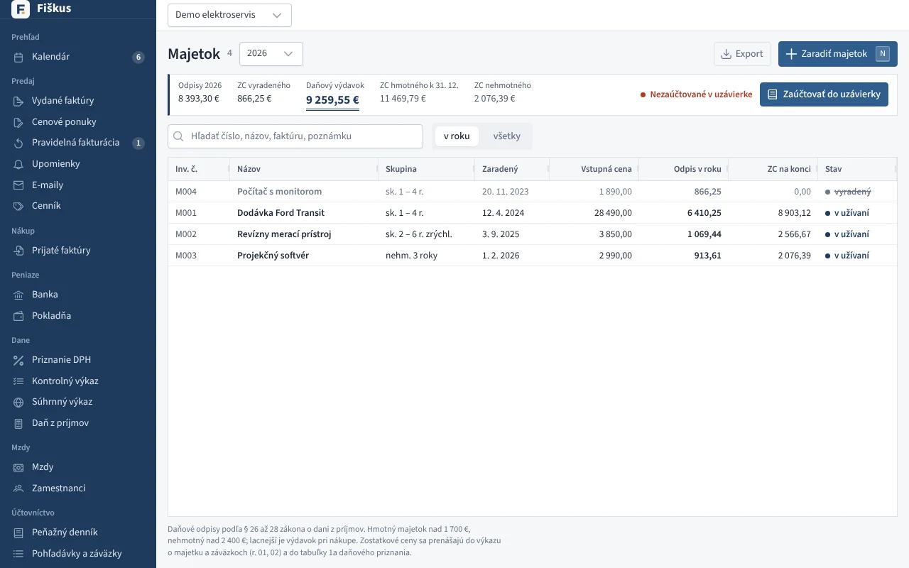
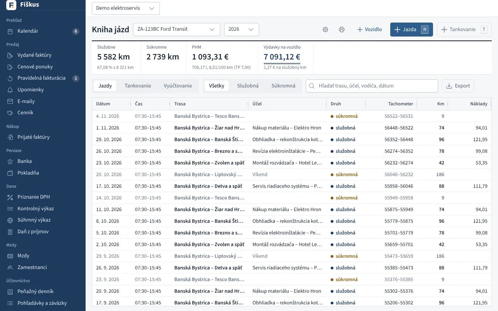
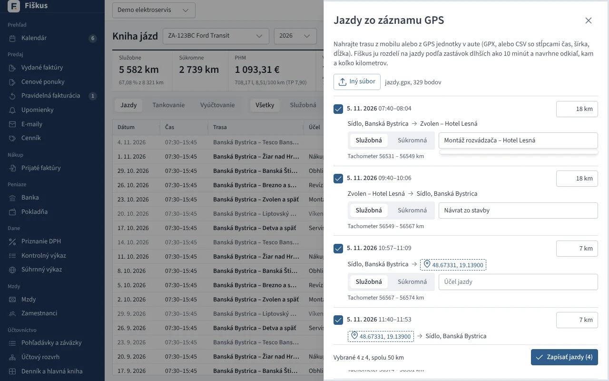

# Majetok a kniha jázd

## Register majetku

Daňové odpisy podľa § 22 – 29 zákona o dani z príjmov:

*Register majetku s daňovými odpismi*

*Karta majetku s odpisovým plánom*

| Voľba | Možnosti |
|---|---|
| odpisová skupina | 0 – 6 |
| metóda | rovnomerná, zrýchlená |
| rok zaradenia | pomerná časť odpisu |
| podiel na podnikaní | percento |
| vyradenie | predaj, likvidácia — zostatková cena do výdavkov |

Odpisový plán sa ukáže na celé obdobie. Odpisy roka prenesiete jedným
tlačidlom do uzávierky (stĺpec e6) a zostatkové ceny do výkazu o majetku.

### Technické zhodnotenie

Prístavbu, modernizáciu alebo rekonštrukciu (nad 1 700 € za rok pri
hmotnom, nad 2 400 € pri nehmotnom majetku) zapíšete na karte majetku:
dátum dokončenia, suma a čo sa robilo. Fiškus podľa § 29 a pokynov
finančnej správy:

- **v roku zaradenia** pripočíta zhodnotenie k vstupnej cene od začiatku —
  aj pomerná časť prvého roka sa počíta zo zvýšenej ceny;
- **neskôr pri rovnomernom odpisovaní** počíta ročný odpis od roku
  zhodnotenia ako zvýšená vstupná cena / doba odpisovania; odpisuje sa,
  kým sa celá cena neodpíše (doba sa predĺži);
- **neskôr pri zrýchlenom odpisovaní** zvýši zostatkovú cenu o zhodnotenie
  a neuplatnenú časť prvého roka a ďalej počíta koeficientom pre zvýšenú
  zostatkovú cenu (6 v 2. skupine, 8 v 3. skupine).

V registri je stĺpec VC s technickým zhodnotením. V podvojnom účtovníctve
sa účtovne zhodnotenie odpisuje počas zvyšku účtovnej doby odpisovania
a pri vyradení sa oprávky zúčtujú proti zvýšenej cene.

### Prerušenie odpisovania

Pri hmotnom majetku môžete daňové odpisovanie na celé roky prerušiť
(§ 22 ods. 9) — vyberte roky v poli **Prerušené odpisovanie**. V tých
rokoch sa odpis neuplatní a potom sa pokračuje, akoby prerušené nebolo;
doba odpisovania sa predĺži. Ak prerušíte už rok zaradenia, prvým rokom
odpisovania je až ďalší rok a uplatní sa v ňom celý ročný odpis.
Pri paušálnych výdavkoch sa odpisovanie neprerušuje.

## Účtovné odpisy (podvojné účtovníctvo)

V podvojnom účtovníctve má každá položka majetku aj **účet** (predvolene
013 softvér, 021 stavby, 022 samostatné hnuteľné veci) a **dobu účtovného
odpisovania v mesiacoch** podľa vášho odpisového plánu. Účtovné odpisy sú
rovnomerné mesačné — od mesiaca po zaradení, naposledy za mesiac pred
vyradením. Bez zadanej doby sú rovnaké ako daňové (bez krátenia podielom
na podnikaní).

*Účet majetku a doba účtovného odpisovania v podvojnom účtovníctve*

V **Účtovnej knihe → Účtovné odpisy** sa za rok zaúčtuje jeden interný
doklad k 31. 12.:

| Operácia | MD | D |
|---|---|---|
| Odpis | 551 | 08x (07x) |
| Zostatková cena predaného majetku | 541 | 08x |
| Zostatková cena pri likvidácii, škode, vklade | 551 | 08x |
| Vyradenie v obstarávacej cene | 08x | 02x (01x) |

Opakované zaúčtovanie doklad nahradí. Rozdiel medzi účtovnými a daňovými
odpismi Fiškus ukáže pri položke aj v súčte — kladný sa v daňovom
priznaní pripočíta k výsledku hospodárenia, záporný sa odpočíta.

## Kniha jázd

Vozidlá (v obchodnom majetku, prenajaté, súkromné), jazdy so stavom
tachometra, účelom a vodičom, tankovanie z bločkov a prijatých faktúr.
Ročné vyúčtovanie: spotreba podľa knihy jázd s limitom z technického
preukazu, alebo paušál 80 % / 50 %; cestovné náhrady za súkromné auto.

*Kniha jázd — služobné a súkromné jazdy, tankovanie, výdavky na vozidlo*

### Jazdy zo záznamu GPS

Jazdy netreba prepisovať ručne. Trasu z mobilu (napr. aplikácia na
záznam trás) alebo z GPS jednotky v aute uložte ako **GPX** alebo **CSV**
so stĺpcami čas, zemepisná šírka a dĺžka a v knihe jázd kliknite na
**Z GPS**.

- Fiškus rozdelí trasu na jazdy podľa zastávok dlhších ako 10 minút
  (aj pri výpadku záznamu) a navrhne dátum, čas odchodu a príchodu,
  odkiaľ, kam a kilometre. Presuny kratšie ako 300 m a skoky GPS vynechá.
- Miesto bez názvu sa ukáže ako súradnice — kliknite naň a pomenujte ho
  (sídlo, sklad, stavba). Pomenované miesta platia pre všetky ďalšie
  záznamy v okruhu 300 m.
- Stav tachometra nadväzuje na poslednú jazdu v knihe. Keď kilometre
  opravíte podľa tachometra, ďalšie jazdy sa posunú.
- Jazda, ktorá už v knihe je (rovnaký deň a čas odchodu), je označená
  „už v knihe“ a predvolene sa nezapíše — ten istý súbor tak môžete
  načítať opakovane.
- Doplňte účel služobných jázd a kliknite na **Zapísať jazdy**. Ak niečo
  chýba, nezapíše sa nič a chybná jazda sa vyznačí.

*Jazdy zo záznamu GPS — návrh jázd s miestami, kilometrami a stavom tachometra*

!!! note "DPH pri vozidlách od roku 2026"
    Pri osobnom aute (M1, L1e, L3e) sa z nákupov odpočíta 50 % DPH. Plný
    odpočet je pri výlučnom podnikateľskom použití (VIN, kniha jázd, dátum
    oznámenia). Vozidlo na prijatej faktúre nastaví odpočet samo.
