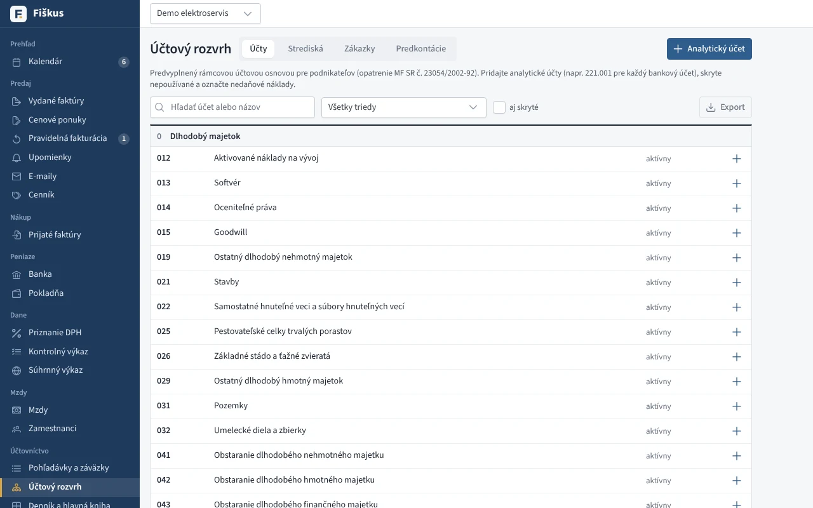
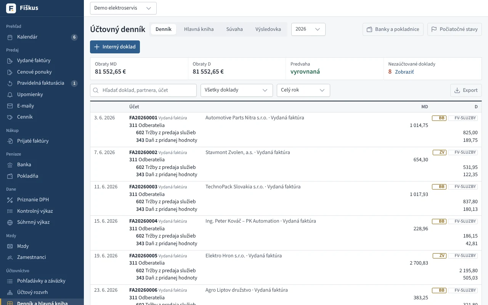
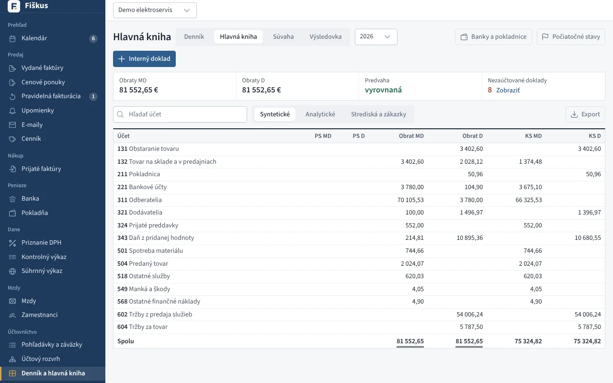
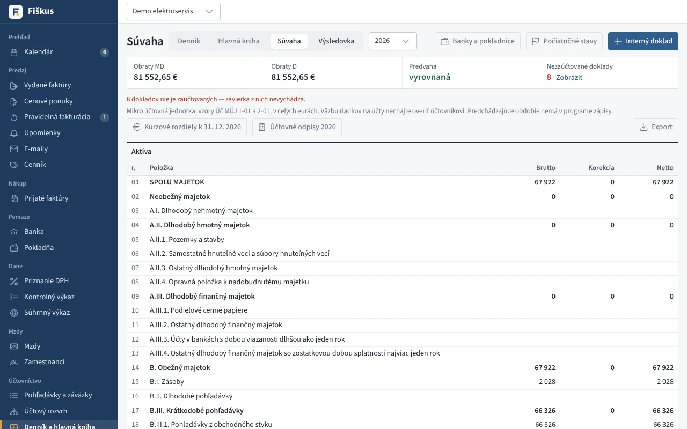
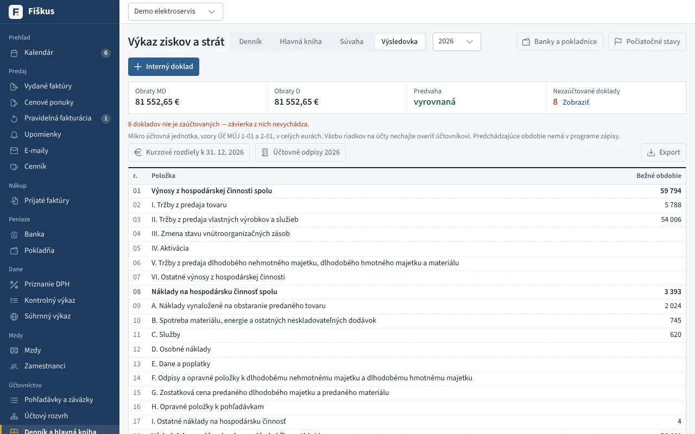

# Podvojné účtovníctvo

## Účtový rozvrh a predkontácie

Rámcová účtová osnova pre podnikateľov (syntetické účty, druh, nedaňové
náklady), analytické účty firmy, strediská a zákazky. **Predkontácie** sú
vzory zaúčtovania — ktorý účet ide na MD, ktorý na D a akú časť sumy
(základ, DPH, celok). Fiškus má predvolené vzory pre bežné doklady a stráži, aby každý vzor bol
vyrovnaný (MD = D).

*Účtový rozvrh podľa rámcovej účtovej osnovy*

## Automatické účtovanie

*Účtovný denník — doklady zaúčtované automaticky podľa predkontácií*

| Doklad | Napríklad |
|---|---|
| vydaná faktúra | 311 / 602 (služby) alebo 604 (tovar) a 343 |
| prijatá faktúra | 501 a 343 / 321 |
| bankový pohyb | 221 / 311 |
| pokladničný doklad | 211 / … |
| skladový doklad | 132 / 131, 504 / 132 — pozri [ocenenie zásob](../sklad/ocenenie.md) |

Každý zápis sa dá zmeniť (iná predkontácia, stredisko, zákazka) a pridať sa
dajú ručné zápisy a interné doklady.

## Knihy a závierka

*Hlavná kniha: obraty a konečné stavy*

*Súvaha mikro účtovnej jednotky*

*Výkaz ziskov a strát*

- **Účtovný denník** — zápisy v časovom poradí.
- **Hlavná kniha** — obratová predvaha, obraty a zostatky účtov.
- **Kurzové rozdiely** pri úhrade v cudzej mene (aj pri čiastočných úhradách z eurového účtu) a k 31. 12.
- **Závierka mikro účtovnej jednotky** — súvaha (Úč MÚJ 1-01) a výkaz
  ziskov a strát (Úč MÚJ 2-01); počiatočné stavy z konečných stavov
  minulého roka.

:::tip[Úloha: od faktúry k súvahe]
V ukážkovej firme prepnite druh účtovníctva na podvojné. Nájdite jednu
vydanú faktúru v účtovnom denníku, sledujte jej zápis na účte 311
v hlavnej knihe a potom jej úhradu z banky. Kde sa pohľadávka objaví
v súvahe, ak úhrada príde až v januári?
:::
