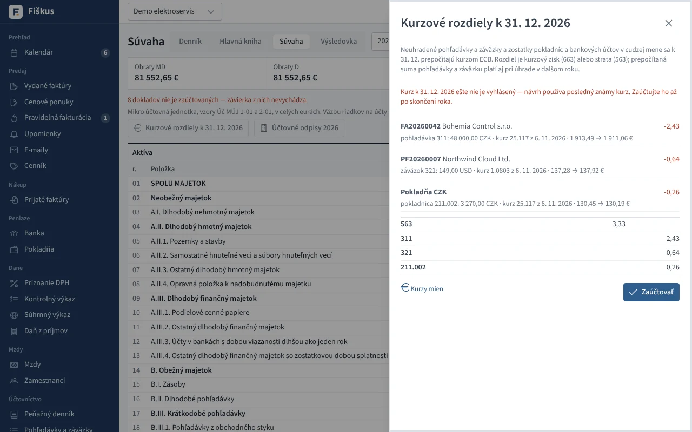

# Podvojné účtovníctvo

## Účtový rozvrh a predkontácie

Rámcová účtová osnova pre podnikateľov (syntetické účty, druh, nedaňové
náklady), analytické účty firmy, strediská a zákazky. **Predkontácie** sú
vzory zaúčtovania — ktorý účet ide na MD, ktorý na D a akú časť sumy
(základ, DPH, celok). Fiškus má predvolené vzory pre bežné doklady a stráži, aby každý vzor bol
vyrovnaný (MD = D).

*Účtový rozvrh podľa rámcovej účtovej osnovy*

## Automatické účtovanie

*Účtovný denník — doklady zaúčtované automaticky podľa predkontácií*

| Doklad | Napríklad |
|---|---|
| vydaná faktúra | 311 / 602 (služby) alebo 604 (tovar) a 343 |
| prijatá faktúra | 501 a 343 / 321 |
| bankový pohyb | 221 / 311 |
| pokladničný doklad | 211 / … |
| skladový doklad | 132 / 131, 504 / 132 — pozri [ocenenie zásob](../sklad/ocenenie.md) |

Každý zápis sa dá zmeniť (iná predkontácia, stredisko, zákazka) a pridať sa
dajú ručné zápisy a interné doklady.

## Knihy a závierka

*Hlavná kniha: obraty a konečné stavy*

*Súvaha mikro účtovnej jednotky*

*Výkaz ziskov a strát*

- **Účtovný denník** — zápisy v časovom poradí.
- **Hlavná kniha** — obratová predvaha, obraty a zostatky účtov.
- **Kurzové rozdiely** pri úhrade v cudzej mene (aj pri čiastočných úhradách z eurového účtu) a k 31. 12.
- **Závierka mikro účtovnej jednotky** — súvaha (Úč MÚJ 1-01) a výkaz
  ziskov a strát (Úč MÚJ 2-01); počiatočné stavy z konečných stavov
  minulého roka.

### Kurzové rozdiely k 31. 12.

V **Súvahe** kliknite na **Kurzové rozdiely k 31. 12.** Fiškus prepočíta
kurzom ECB k 31. 12. všetko, čo je v cudzej mene:

- **neuhradené pohľadávky a záväzky** (311, 321). Prepočítaná suma platí aj
  pri úhrade v ďalšom roku,
- **pokladnice v cudzej mene**. Zostatok v mene je súčet dokladov, suma
  v účtovníctve je súčet dokladov v eurách (kurz ku dňu dokladu). Od
  ďalšieho roka sa začína prepočítanou sumou,
- **bankové účty v cudzej mene**. Pohyby v cudzej mene sa účtujú ručne
  v eurách na analytický účet banky, preto suma v účtovníctve je zostatok
  tohto účtu v hlavnej knihe. Zostatok v mene je súčet pohybov vo Fiškuse.
  Ak sa líši od výpisu (napríklad účet bol založený pred používaním
  Fiškusa), zadajte do riadku **Zostatok podľa výpisu k 31. 12.** sumu
  z výpisu.

Rozdiel je kurzový zisk (663) alebo strata (563) proti účtu pohľadávky,
záväzku, pokladnice alebo banky. Pokladnice a banky sa účtujú na ich
analytické účty z **Účty bánk a pokladníc**. Bankový účet v cudzej mene bez
analytického účtu alebo s nezaúčtovanými pohybmi Fiškus nepreráta a upozorní
na to. **Zaúčtovať** vytvorí interný doklad k 31. 12. Ďalšie zaúčtovanie ho
nahradí, takže po doplnení kurzu alebo pohybov stačí kliknúť znova.

*Kurzové rozdiely k 31. 12.: pohľadávka, záväzok a pokladnica v CZK*

:::tip[Úloha: od faktúry k súvahe]
V ukážkovej firme prepnite druh účtovníctva na podvojné. Nájdite jednu
vydanú faktúru v účtovnom denníku, sledujte jej zápis na účte 311
v hlavnej knihe a potom jej úhradu z banky. Kde sa pohľadávka objaví
v súvahe, ak úhrada príde až v januári?
:::
