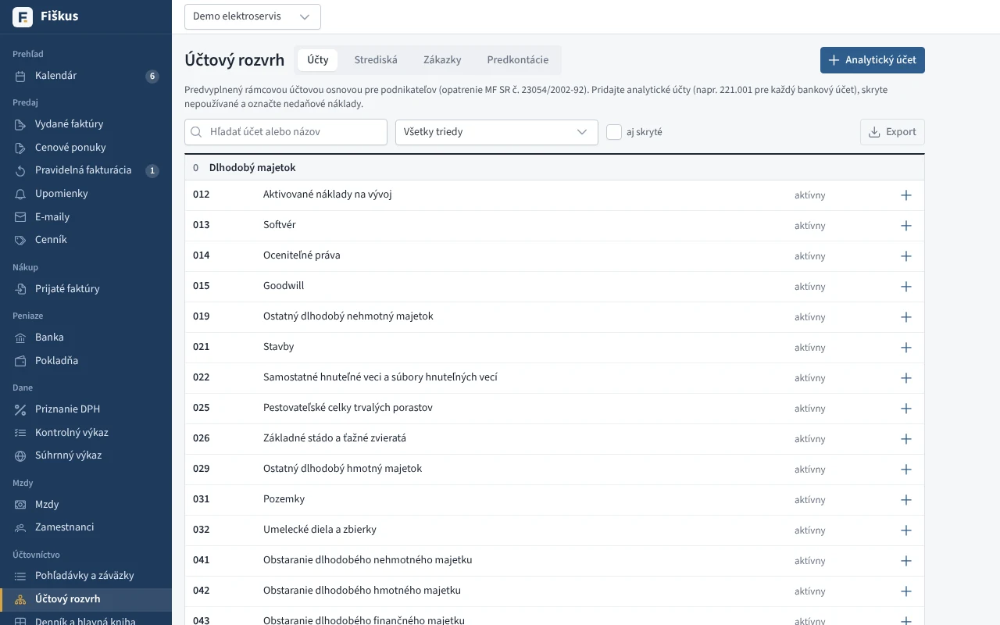
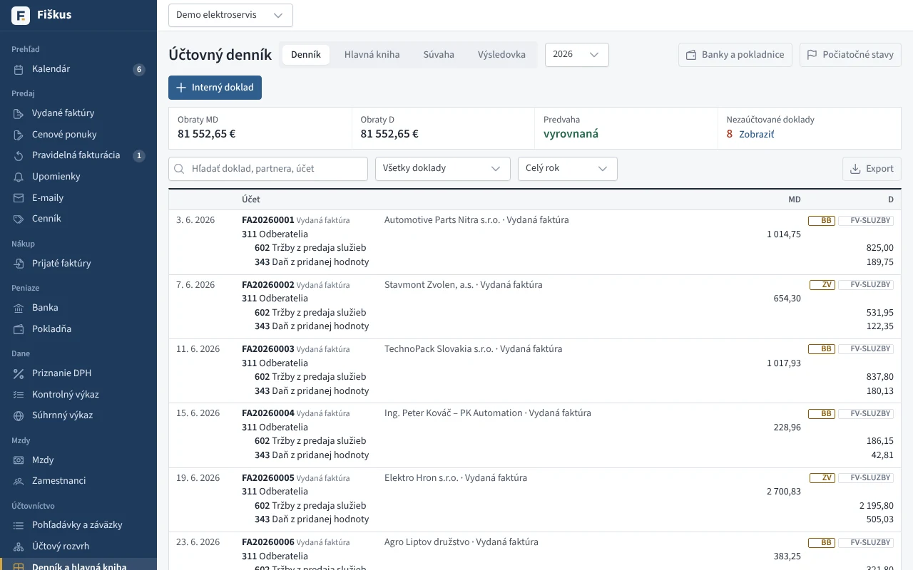
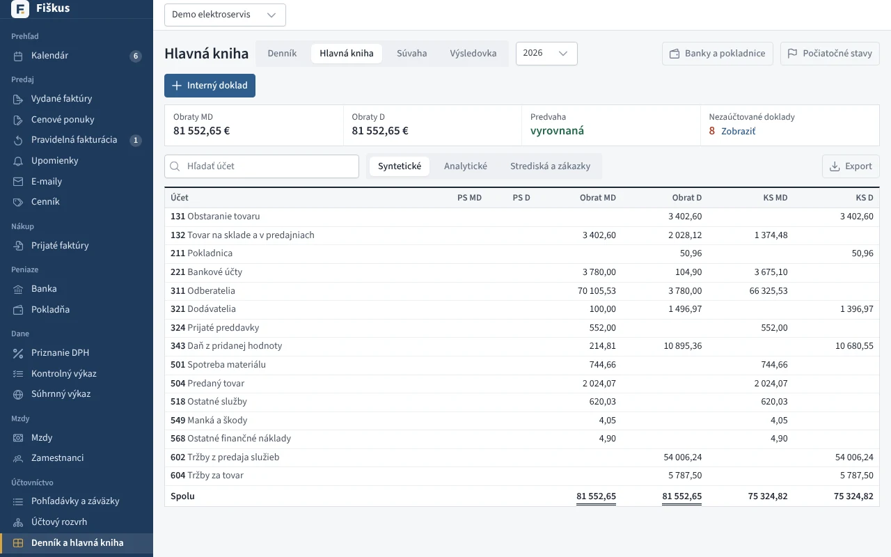
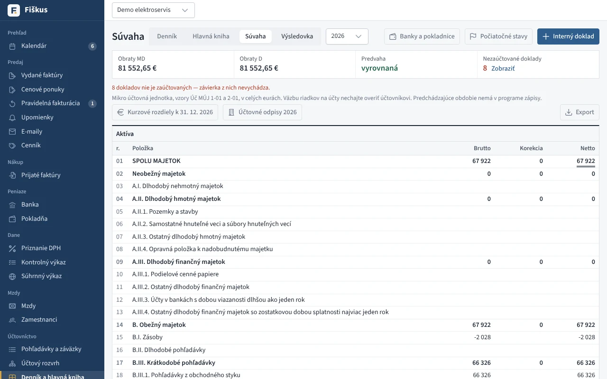
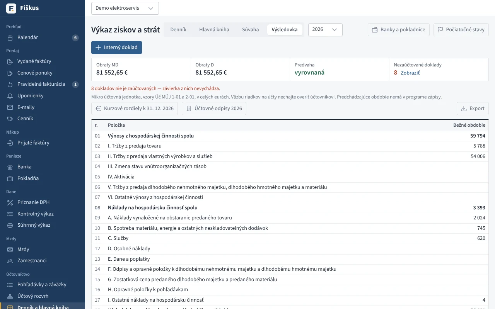
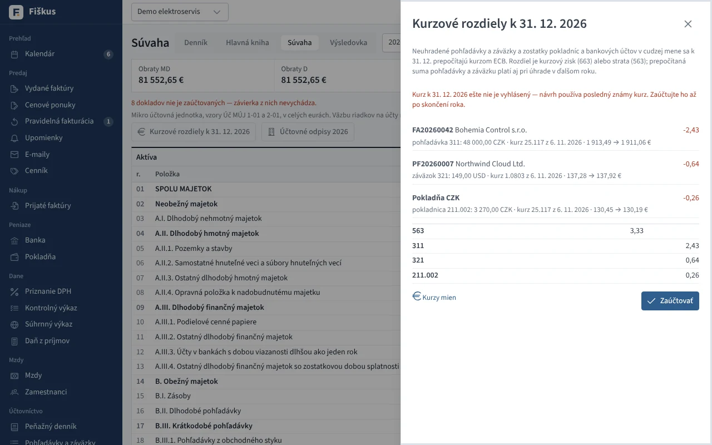

# Podvojné účtovníctvo

## Účtový rozvrh a predkontácie

Rámcová účtová osnova pre podnikateľov (syntetické účty, druh, nedaňové
náklady), analytické účty firmy, strediská a zákazky. **Predkontácie** sú
vzory zaúčtovania — ktorý účet ide na MD, ktorý na D a akú časť sumy
(základ, DPH, celok). Fiškus má predvolené vzory pre bežné doklady a stráži, aby každý vzor bol
vyrovnaný (MD = D).

*Účtový rozvrh podľa rámcovej účtovej osnovy*

## Automatické účtovanie

*Účtovný denník — doklady zaúčtované automaticky podľa predkontácií*

| Doklad | Napríklad |
|---|---|
| vydaná faktúra | 311 / 602 (služby) alebo 604 (tovar) a 343 |
| prijatá faktúra | 518 (služby), 501 a 343 / 321; zásoby s príjemkou 131 (tovar) alebo 111 (materiál) |
| bankový pohyb | 221 / 311 |
| pokladničný doklad | 211 / … |
| skladový doklad | 132 / 131, 504 / 132 — pozri [ocenenie zásob](../sklad/ocenenie.md) |

Pri prijatej faktúre s druhom výdavku *Zásoby* rozhoduje príjemka, ktorá
je k faktúre pripojená: tovar sa obstaráva na 131, materiál na sklad na 111
(príjemka ich preúčtuje na 132 a 112, takže obstarávacie účty nemajú
zostatok). Bez príjemky ide materiál priamo do spotreby na 501. Ak sú na
príjemkách tovar aj materiál, Fiškus predkontáciu nenavrhne a faktúru
zaúčtujete ručne.

Ak majú obstarávacie účty 111 alebo 131 zostatok (napr. príjemka bez
pripojenej prijatej faktúry — príjemka účtuje 132/131, faktúra bez príjemky
ide na 501), Fiškus na to upozorní pri súvahe aj v kontrolách uzávierky
roka a uvedie počet takých príjemok. Pripojte faktúru k príjemke; tovar,
ku ktorému faktúra ešte neprišla, patrí na konci roka na 326
(nevyfakturované dodávky), faktúra bez príjemky na 139 alebo 119 (na
ceste).

Každý zápis sa dá zmeniť (iná predkontácia, stredisko, zákazka) a pridať sa
dajú ručné zápisy a interné doklady.

## Knihy a závierka

*Hlavná kniha: obraty a konečné stavy*

*Súvaha mikro účtovnej jednotky*

*Výkaz ziskov a strát*

- **Účtovný denník** — zápisy v časovom poradí.
- **Hlavná kniha** — obratová predvaha, obraty a zostatky účtov.
- **Kurzové rozdiely** pri úhrade v cudzej mene (aj pri čiastočných úhradách z eurového účtu) a k 31. 12.
- **Účtovná závierka** — súvaha a výkaz ziskov a strát mikro účtovnej
  jednotky (Úč MÚJ 1-01 a 2-01) alebo malej účtovnej jednotky (Úč POD
  1-01 a 2-01); počiatočné stavy z konečných stavov minulého roka.

**Vzor závierky** zvolíte nad súvahou pre každý rok zvlášť — veľkosť
účtovnej jednotky (§ 2 ods. 5 zákona o účtovníctve) určujete sami.
Predvolená je mikro účtovná jednotka. Riadky malej účtovnej jednotky sú
podľa šablóny registra účtovných závierok (súvaha r. 01 – 145, výkaz
ziskov a strát r. 01 – 61; výsledok v r. 100 súvahy = r. 61 výkazu).
Fiškus nerozlišuje položky voči prepojeným účtovným jednotkám a v rámci
podielovej účasti ani dlhodobé pohľadávky a záväzky — zostatky sú
v riadkoch „ostatné“ a krátkodobé; výsledok minulého roka, o ktorom
ešte nerozhodli (431), je v r. 98 alebo 99. Čistý obrat (r. 01 výkazu)
sú tržby z predaja výrobkov, tovaru a služieb (601, 602, 604, 606, 607).
Prejdite riadky s účtovníkom.

### Uzávierka roka

Na karte **Súvaha** alebo **Výsledovka** pri minulom roku je panel
**Uzávierka roka**. Rok sa dá uzavrieť, keď:

- rok skončil,
- všetky doklady sú zaúčtované,
- hlavná kniha je vyrovnaná (MD = D, počiatočné stavy sedia).

Upozorní aj na účty so zostatkom mimo riadkov závierky a na neuzavretý
predchádzajúci rok (uzávierku to neblokuje).

Po uzavretí:

- doklady, pohyby peňazí, interné doklady, počiatočné stavy aj
  zaúčtovanie dokladov s dátumom v roku sa uzamknú;
- uloží sa súhrn: výnosy, náklady a výsledok hospodárenia;
- konečné stavy súvahových účtov sa prenesú ako **počiatočné stavy
  ďalšieho roka** (výsledok hospodárenia na 431) — iba ak ďalší rok ešte
  nemá počiatočné stavy zadané, inak ostanú.

Rok sa dá znova otvoriť s uvedením dôvodu (zapíše sa do auditu); po
oprave ho znova uzavrite. Pred kurzovými rozdielmi a účtovnými odpismi
za rok rok neuzavierajte — po uzavretí sa už nedajú zaúčtovať.

**Uzávierkové zápisy** v paneli ukážu uzavretie účtovných kníh podľa
postupov účtovania (účtová trieda 7):

| Zápis | Dátum | Účty |
|---|---|---|
| uzavretie nákladov | 31. 12. | 710 MD / 5xx D |
| uzavretie výnosov | 31. 12. | 6xx MD / 710 D |
| prevod výsledku | 31. 12. | zisk 710 / 702, strata 702 / 710 |
| uzavretie súvahových účtov | 31. 12. | aktíva 702 / účet, pasíva účet / 702 |
| otvorenie | 1. 1. | aktíva účet / 701, pasíva 701 / účet, výsledok na 431 |

Po zápisoch majú všetky účty vrátane 702 a 710 nulový zostatok. Do
obratov roka sa nezapočítavajú — súvaha a výkaz ziskov a strát sú zo
zostatkov pred uzavretím. Kým rok nie je uzavretý, zápisy sú návrh podľa
súčasných zostatkov. Dajú sa vytlačiť a exportovať do Excelu aj CSV.

### Kurzové rozdiely k 31. 12.

V **Súvahe** kliknite na **Kurzové rozdiely k 31. 12.** Fiškus prepočíta
kurzom ECB k 31. 12. všetko, čo je v cudzej mene:

- **neuhradené pohľadávky a záväzky** (311, 321). Prepočítaná suma platí aj
  pri úhrade v ďalšom roku,
- **pokladnice v cudzej mene**. Zostatok v mene je súčet dokladov, suma
  v účtovníctve je súčet dokladov v eurách (kurz ku dňu dokladu). Od
  ďalšieho roka sa začína prepočítanou sumou,
- **bankové účty v cudzej mene**. Pohyby v cudzej mene sa účtujú ručne
  v eurách na analytický účet banky, preto suma v účtovníctve je zostatok
  tohto účtu v hlavnej knihe. Zostatok v mene je súčet pohybov vo Fiškuse.
  Ak sa líši od výpisu (napríklad účet bol založený pred používaním
  Fiškusa), zadajte do riadku **Zostatok podľa výpisu k 31. 12.** sumu
  z výpisu.

Rozdiel je kurzový zisk (663) alebo strata (563) proti účtu pohľadávky,
záväzku, pokladnice alebo banky. Pokladnice a banky sa účtujú na ich
analytické účty z **Účty bánk a pokladníc**. Bankový účet v cudzej mene bez
analytického účtu alebo s nezaúčtovanými pohybmi Fiškus nepreráta a upozorní
na to. **Zaúčtovať** vytvorí interný doklad k 31. 12. Ďalšie zaúčtovanie ho
nahradí, takže po doplnení kurzu alebo pohybov stačí kliknúť znova.

*Kurzové rozdiely k 31. 12.: pohľadávka, záväzok a pokladnica v CZK*

:::tip[Úloha: od faktúry k súvahe]
V ukážkovej firme prepnite druh účtovníctva na podvojné. Nájdite jednu
vydanú faktúru v účtovnom denníku, sledujte jej zápis na účte 311
v hlavnej knihe a potom jej úhradu z banky. Kde sa pohľadávka objaví
v súvahe, ak úhrada príde až v januári?
:::
