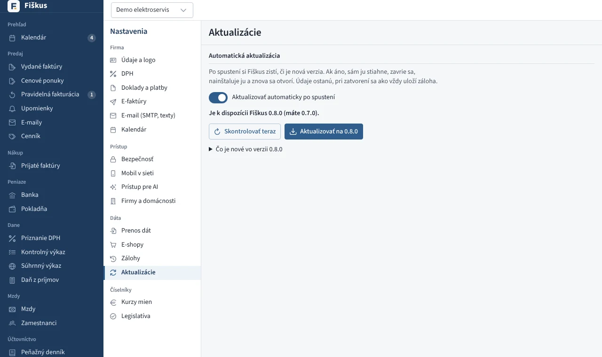
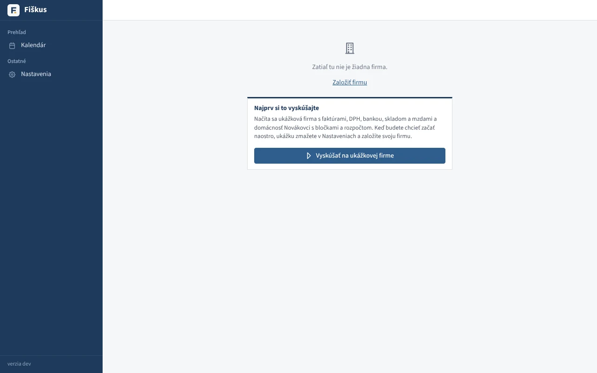
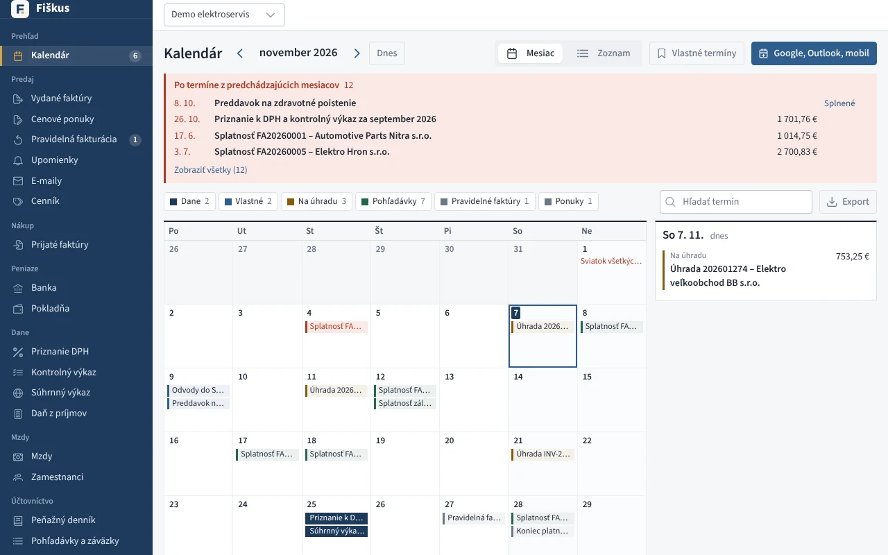

# Inštalácia

## Na vlastnom počítači

| Systém | Súbor | Poznámka |
|---|---|---|
| Windows | `fiskus-…-windows-setup.exe` | inštalácia bez práv správcu, ikona v ponuke Štart a pri hodinách |
| macOS | `fiskus-…-macos.dmg` | Apple Silicon aj Intel; prvé spustenie cez pravé tlačidlo → Otvoriť |
| Linux | `.deb`, `.rpm` | ikona v ponuke aplikácií |

Po spustení Fiškus otvorí prehliadač na adrese `http://127.0.0.1:48080`.
Dáta sú v priečinku používateľa:

| Systém | Priečinok |
|---|---|
| Windows | `%APPDATA%\Fiskus` |
| macOS | `~/Library/Application Support/Fiskus` |
| Linux | `~/.local/share/fiskus` |

:::tip[Druhé spustenie]
Ak Fiškus už beží, ikona iba otvorí jeho okno. Vo Windows ho ukončíte
pravým tlačidlom na ikone pri hodinách → **Ukončiť**.
:::

### Aktualizácia

Fiškus sa aktualizuje sám. Po spustení zistí, či je nová verzia. Ak áno,
stiahne ju, zavrie sa, nainštaluje ju a znova sa otvorí. Otvorené okno sa
samo načíta. Počas toho okno ukazuje priebeh, takže sa nič rozpracované
nestratí. Pri zatvorení sa ako vždy uloží záloha.

- Stiahnutý súbor sa pred inštaláciou overí súčtom SHA-256 z vydania na
  GitHube; ak nesedí, nič sa nenainštaluje.
- Sťahovanie sa dá zastaviť tlačidlom **Teraz nie**. Aktualizácia potom
  počká na ďalšie spustenie.
- V **Nastaveniach → Aktualizácie** sa dá automatická aktualizácia
  vypnúť, novú verziu zistiť hneď alebo nainštalovať tlačidlom.
- Na Linuxe s balíkom `.deb` alebo `.rpm` si inštalácia vypýta heslo
  správcu. Ak sa Fiškus sám aktualizovať nedá (napríklad do jeho priečinka
  sa nedá zapisovať), Nastavenia ukážu odkaz na stiahnutie.


*Nastavenia → Aktualizácie*

## V prehliadači bez inštalácie

Fiškus sa dá spustiť aj priamo v prehliadači, bez inštalácie. Celý program
beží vo vašom prehliadači (WebAssembly) a údaje sú v úložisku prehliadača
**iba na vašom počítači** — na server sa neposielajú. Prvé otvorenie
stiahne asi 7 MB, ďalšie spustenia trvajú sekundu a fungujú aj bez internetu.

Funkcie, ktoré potrebujú nainštalovaný program, sú v rozhraní na svojom
mieste; po kliknutí Fiškus ponúkne stiahnutie inštalačky:

| Funkcia | Prečo potrebuje inštaláciu |
|---|---|
| Vyhľadanie firmy podľa IČO, overenie IČ DPH, kurzy a sadzba ECB | prehliadač z cudzej stránky nesmie volať iné služby (údaje zadáte ručne) |
| Odosielanie e-mailov, e-faktúry cez poštára, zdieľanie ponuky odkazom | potrebujú spojenie na poštový server alebo verejnú adresu |
| Čítanie dokladov a bločkov cez AI, bločky z eKasy | volanie Claude API a eKasy |
| E-shopy, Google a Outlook kalendár, odber kalendára | prepojenie s inými službami |
| Mobil v sieti, pripojenie AI asistenta (MCP) | program musí počúvať v sieti |
| Automatické zálohy do priečinka a do cloudu | prehliadač nemá prístup k priečinkom |

Ostatné — faktúry, nákupy, banka (import výpisu), pokladňa, sklad,
účtovníctvo, DPH, daň z príjmov, domácnosť — funguje rovnako ako
v nainštalovanom Fiškuse. Pravidelné faktúry sa vytvárajú, keď je Fiškus otvorený.

:::warning[Zálohy]
Ak vymažete údaje stránok, preinštalujete počítač alebo otvoríte Fiškus
v inom prehliadači, údaje tam nebudú. V časti **Nastavenia → Zálohy**
si stiahnite šifrovanú zálohu (`.fbk`); Fiškus to pripomenie, ak záloha
chýba alebo je staršia ako 7 dní. Fiškus môže byť otvorený iba v jednej karte.
:::

Záloha z prehliadača je v rovnakom formáte ako zálohy nainštalovaného
Fiškusa. Na prechod stačí súbor zálohy skopírovať do priečinka záloh
nainštalovaného Fiškusa a v **Zálohách** ho obnoviť; opačne ho v prehliadači
obnovíte v časti **Obnoviť zo zálohy**.

Zostavenie zo zdrojového kódu: `make browser` vytvorí statický web
v `frontend/dist-browser`. Nahrá sa na ľubovoľný hosting s HTTPS do koreňa
domény (napr. `app.fiskus.online`); server nič nepočíta, iba posiela súbory.
Program je v ňom už skomprimovaný (asi 6 MB) a súčasťou sú `404.html`
(hosting bez presmerovania adries) a `_headers` (cache).

Nasadenie na Cloudflare Pages (pripojenie repozitára z GitHubu):

| Nastavenie | Hodnota |
|---|---|
| Build command | `cd frontend && npm ci && cd .. && make browser` |
| Build output directory | `frontend/dist-browser` |
| Premenné prostredia | `GO_VERSION` = verzia z `backend/go.mod`, `NODE_VERSION` = `22` |
| Vlastná doména | `app.fiskus.online` |

## Ukážková firma

Na výučbu a skúšanie je najlepšia ukážková firma **Demo elektroservis**:
faktúry, nákupy, banka, pokladňa, sklad s kartami produktov, majetok aj
kniha jázd.

Najjednoduchšie ju načítate v prázdnom Fiškuse — nainštalovanom aj
v prehliadači — tlačidlom **Vyskúšať na ukážkovej firme**. Spolu s firmou
sa načíta aj domácnosť Novákovci s bločkami, rozpočtom a plánom platieb.
Keď budete chcieť začať naostro, ukážku zmažete v **Nastavenia → Údaje
a logo → Zmazať firmu** (a domácnosť rovnako) a založíte svoju firmu.


*Prázdny Fiškus ponúkne ukážkovú firmu*


*Ukážková firma po spustení: kalendár termínov s daňami a splatnosťami*


```sh
make demo                      # zo zdrojového kódu, http://127.0.0.1:8080
fiskus -demo -addr 127.0.0.1:8080
```

Ukážkové dáta sú iba v pamäti — po ukončení programu zmiznú a pri ďalšom
spustení sú znova pôvodné. Študent tak nič nepokazí.

## Na serveri

```sh
fiskus -mode server -addr :8080 -db /data/fiskus.db
```

Serverová verzia má prihlasovanie, povinné dvojfázové overenie, roly
používateľov a ľubovoľný počet firiem. Za reverznou proxy ju spustite
s `-public-url https://vas-server`, aby odkazy (ponuky pre zákazníkov,
pripojenie AI asistenta) mali správnu adresu.

!!! note "Bez licencií"
    Desktop, server aj Fiškus v prehliadači majú všetky funkcie, bez licencií
    a bez obmedzenia počtu firiem.
