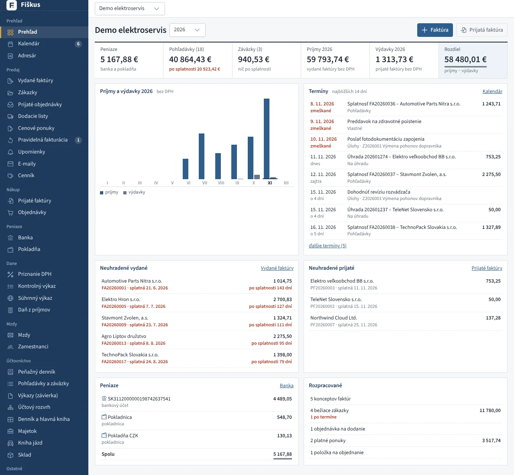

# Prehľad

Po otvorení firmy sa zobrazí **Prehľad** (v menu prvá položka). Na jednej
stránke je všetko podstatné o firme za zvolený rok. Každé číslo aj riadok
sa dá rozkliknúť na doklady, z ktorých vznikli.

*Prehľad firmy*

## Hlavné čísla

| Číslo | Čo ukazuje |
|---|---|
| Peniaze | zostatky bankových účtov a pokladníc (z peňažného denníka alebo z účtov 211 a 221 v hlavnej knihe) |
| Pohľadávky | neuhradené vydané faktúry v eurách, z toho po splatnosti |
| Záväzky | neuhradené prijaté faktúry, z toho po splatnosti |
| Príjmy a výdavky | vydané a prijaté faktúry za rok podľa dátumu dodania (u platiteľa DPH bez DPH) |
| Rozdiel | príjmy mínus výdavky |

## Graf, termíny a zoznamy

- **Príjmy a výdavky po mesiacoch** — stĺpcový graf za rok, aktuálny
  mesiac je zvýraznený. Presnú sumu ukáže kurzor nad stĺpcom.
- **Termíny** — zmeškané termíny a termíny na najbližších 14 dní
  z [kalendára](../dane/index.md#kalendar-terminov): daňové lehoty,
  splatnosti, úlohy, vlastné termíny.
- **Neuhradené vydané a prijaté** — najstaršie po splatnosti, inak
  najbližšie splatné.
- **Peniaze** — zostatok každého bankového účtu a pokladne.
- **Rozpracované** — koncepty faktúr, bežiace zákazky, prijaté
  objednávky na dodanie, platné ponuky a položky na objednanie.

Rokom hore v hlavičke sa prepnete na minulé roky (peniaze a neuhradené
doklady sú potom k 31. 12.). Kto nemá právo na niektorú časť (napríklad
účtovník bez prístupu k banke), tú časť nevidí.

V **domácnosti** je úvodnou stránkou [prehľad domácnosti](../domacnost/index.md)
so zostatkami účtov, najbližšími platbami, termínmi z kalendára, rozpočtom
a grafom príjmov a výdavkov.
