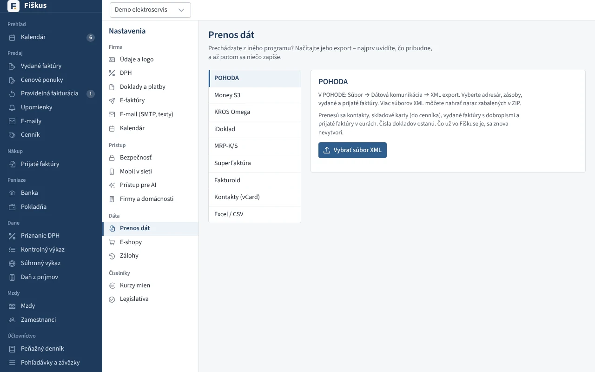

# Prenos dát z iného programu

Prenos je v **Nastaveniach → Prenos dát**. Vždy najprv uvidíte náhľad: čo
pribudne, čo sa zmení a čo sa preskočí a prečo. Až potom sa zapíše.

*Prenos dát: výber programu a súboru, najprv náhľad, potom zápis*

| Program | Formát | Čo sa prenesie |
|---|---|---|
| POHODA | XML export (aj Windows-1250) | adresár, zásoby do cenníka, vydané faktúry a dobropisy s pôvodnými číslami a úhradami, prijaté faktúry |
| Money S3 | XML (slovenská aj česká verzia) | adresár, zásoby, vydané a prijaté faktúry, dobropisy |
| KROS Omega | textový export | partneri, skladové karty, fakturácia, doklady s úhradami |
| MRP-K/S | export faktúr | vydané a prijaté faktúry, adresy s IBAN, dobropisy, úhrady |
| iDoklad | export pre POHODU (ZIP) | faktúry, kontakty z odberateľov |
| SuperFaktúra, Fakturoid | ich export pre účtovníka | formát sa rozpozná sám, aj v ZIP |
| ľubovoľný program | tabuľka Excel / CSV | adresár, cenník, vydané alebo prijaté faktúry, cenové ponuky; vzory na stiahnutie |

Ďalšie dovozy sú priamo pri zoznamoch:

- **Adresár** — vizitky vCard a exporty z Outlooku a Google Kontaktov.
- **Cenník** — Excel/CSV vrátane EAN, kategórie, parametrov a nákupnej ceny;
  stĺpce, ktoré v súbore nie sú, ostanú na kartách nezmenené.
- **Počiatočné stavy účtov** — konečná súvaha alebo predvaha z iného
  programu.

:::tip[Číselný rad pokračuje]
Po prenose faktúr s pôvodnými číslami pokračuje číselný rad za posledným
preneseným číslom, takže v radoch nevzniknú diery ani duplicity.
:::

## Cenové ponuky z tabuľky

Zoznam cenových ponúk exportovaný do Excelu alebo CSV sa prenesie
s pôvodnými číslami a stavmi. Nadpis a dátum exportu nad tabuľkou nevadia.
Druh tabuľky sa rozpozná podľa stĺpcov *Číslo cenovej ponuky* a
*Platnosť do*.

- Popis ponuky je predmet (prvý riadok) a úvodný text (ďalšie riadky),
  suma je jedna položka.
- Stav: *vyfakturovaná*, *prijatá*, *odmietnutá*; ostatné (napríklad
  *vytvorená*) sú vystavené ponuky.
- Vyfakturovaná ponuka sa spojí s faktúrou, ak je vo Fiškuse faktúra
  rovnakému odberateľovi s rovnakou sumou, vystavená v deň ponuky alebo
  neskôr.
- Odberatelia, ktorí v adresári ešte nie sú, sa doň pridajú.
- Nové ponuky vo Fiškuse preskočia čísla, ktoré už majú prenesené ponuky.

Číslo vystavenej ponuky sa dá zmeniť aj ručne: na ponuke **Zmeniť číslo**
(napríklad na pôvodné číslo z iného programu). Číslo musí byť jedinečné a
zmena sa zapíše do auditu. Faktúry takto prečíslovať nejde, sú to daňové
doklady.

